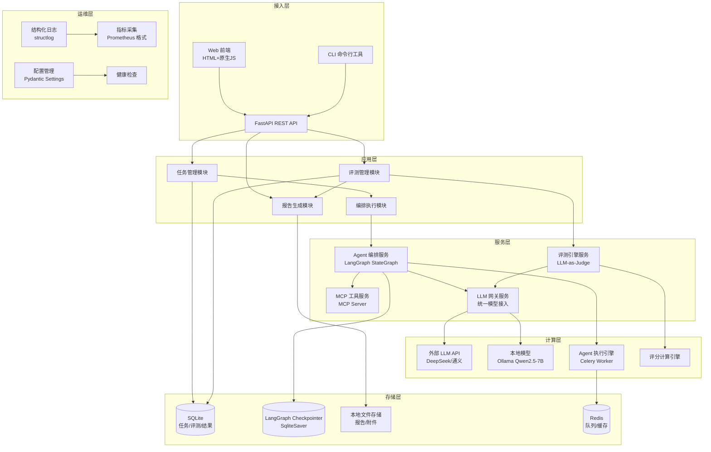
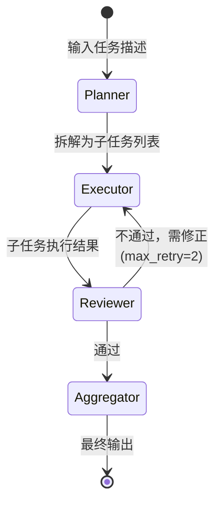
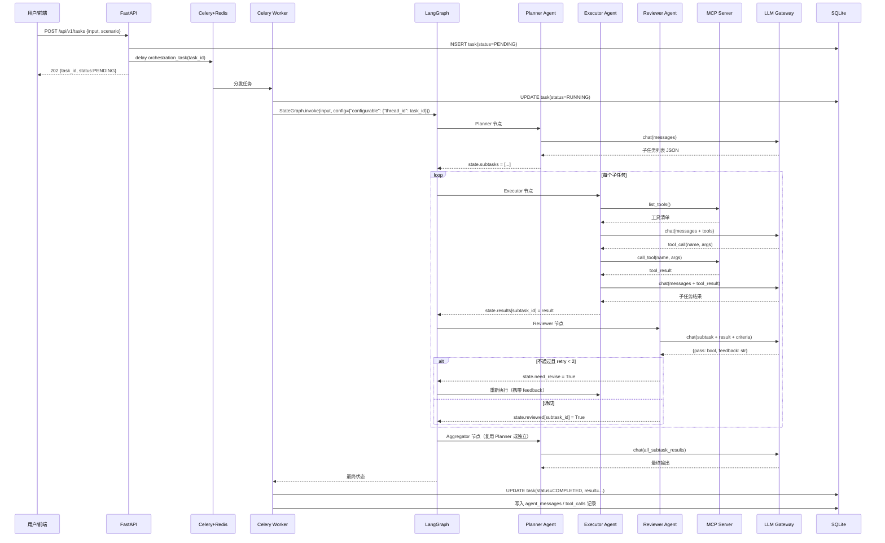
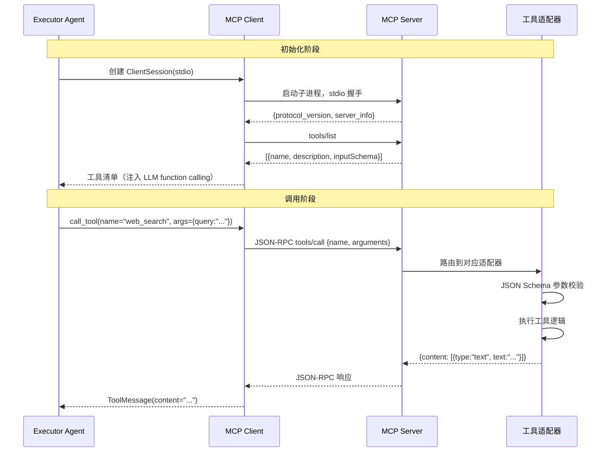
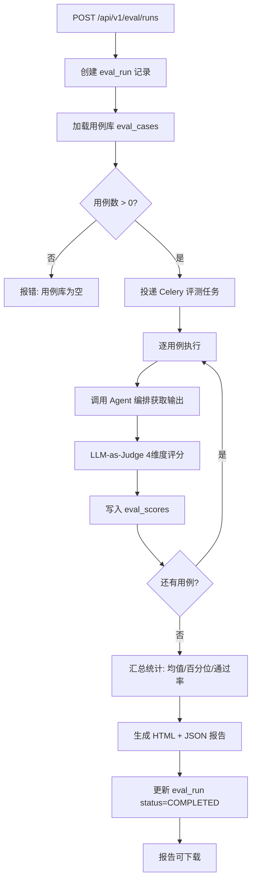
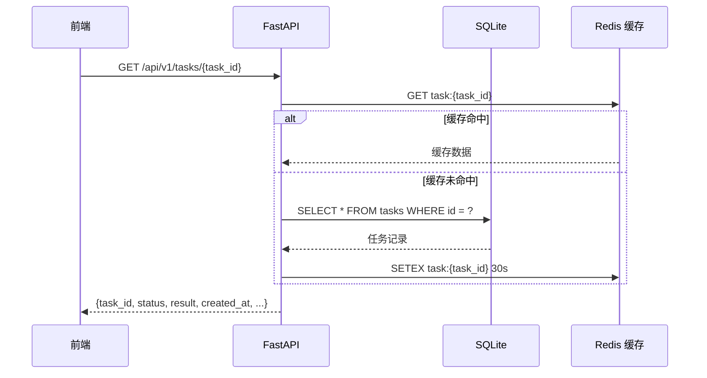
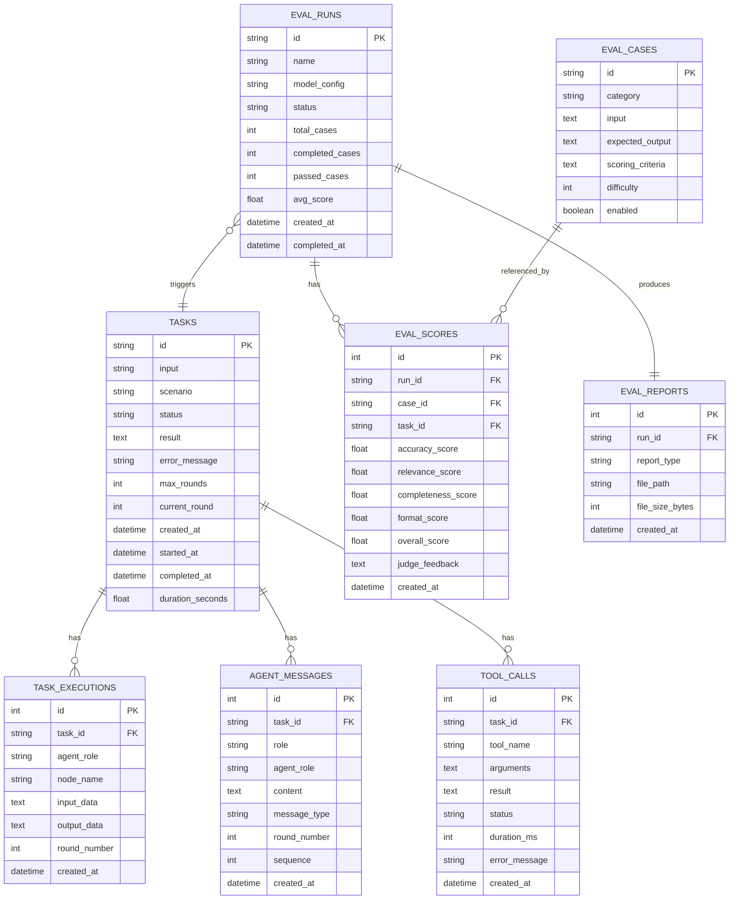

# 《第一轮技术架构设计文档》

**项目名称**：多智能体编排与模型评测一体化平台
**文档版本**：v1.0（第一轮）
**基线依据**：《项目基线说明书》v1.0（2026-10-05）
**设计日期**：2026-10-05
**文档状态**：评审稿

---

## 目录

1. [技术选型说明](#1-技术选型说明)
2. [整体分层架构](#2-整体分层架构)
3. [核心业务链路](#3-核心业务链路)
4. [数据模型设计](#4-数据模型设计)
5. [接口规范定义](#5-接口规范定义)
6. [部署架构设计](#6-部署架构设计)
7. [监控与运维](#7-监控与运维)
8. [技术风险与应对方案](#8-技术风险与应对方案)

---

## 1. 技术选型说明

### 1.1 选型总览

| 层级 | 组件 | 选定版本 | 许可证 | 选型理由 |
|---|---|---|---|---|
| 编排引擎 | LangGraph | 0.2.x | MIT | 基线硬约束；原生支持状态图、检查点、人机协作，是当前多 Agent 编排事实标准 |
| LLM 抽象 | LangChain | 0.3.x | MIT | 与 LangGraph 同生态，提供统一 LLM/工具/消息接口，降低模型切换成本 |
| 工具协议 | MCP Python SDK | 0.1.x | MIT | 基线硬约束；Anthropic 提出的开放协议，实现工具即插即用 |
| Web 框架 | FastAPI | 0.115.x | MIT | 异步高性能、自动生成 OpenAPI 文档、Pydantic 数据校验，Python 生态首选 |
| 任务队列 | Celery | 5.4.x | BSD-3 | 行业标准异步任务框架，支持重试、超时、结果后端；单机多进程架构满足需求 |
| 消息代理 | Redis | 7.4.x | BSD-3 | Celery 默认 broker，轻量、docker-compose 一键启动，同时兼作缓存 |
| 关系数据库 | SQLite | 3.45+（Python 内置） | Public Domain | 基线硬约束；零配置、单文件、满足单机并发读写需求 |
| ORM | SQLAlchemy | 2.0.x | MIT | 类型安全的异步 ORM，支持 Alembic 迁移，与 FastAPI 无缝集成 |
| 数据库迁移 | Alembic | 1.13.x | MIT | SQLAlchemy 官方迁移工具，版本化管理表结构变更 |
| 前端 | 纯 HTML + 原生 JS（ES6+） | — | — | 基线约束不引入重型框架；静态文件由 FastAPI 托管，零构建步骤 |
| 配置管理 | Pydantic Settings | 2.5.x | MIT | 类型安全的配置加载，支持环境变量与 YAML 文件覆盖 |
| 结构化日志 | structlog | 24.4.x | MIT/Apache-2.0 | JSON 结构化日志，支持 trace_id 透传，便于链路追踪 |
| 测试框架 | pytest | 8.3.x | MIT | Python 事实标准测试框架，插件生态丰富 |
| 覆盖率 | pytest-cov | 5.0.x | MIT | 行覆盖率统计，满足 ≥60% 指标要求 |
| API 测试 | httpx | 0.27.x | BSD-3 | 异步 HTTP 客户端，支持 FastAPI TestClient 模式 |
| 容器化 | Docker + docker-compose | 24.x / 2.20+ | Apache-2.0 | 基线要求一键启动；多服务编排标准方案 |
| 代码规范 | Ruff | 0.6.x | MIT | 极速 lint + format 一体化，替代 flake8+black+isort |
| 类型检查 | mypy | 1.11.x | MIT | 静态类型检查，提升代码可维护性 |

### 1.2 关键选型决策说明

#### 1.2.1 为什么用 Celery + Redis 而非 FastAPI BackgroundTasks

基线要求任务支持"异步提交、状态轮询、结果回调"，且单任务 P95 ≤ 90s。BackgroundTasks 存在三个硬伤：

1. **进程耦合**：API 进程重启则所有在途任务丢失，无法满足 M-04（状态可追溯）
2. **无持久化队列**：高并发提交时任务积压在内存，无削峰能力
3. **无重试/超时控制**：Agent 任务涉及外部 LLM API，网络波动时需要自动重试

Celery + Redis 以 docker-compose 额外一个容器的代价，获得持久化队列、自动重试、超时控制、任务状态持久化等工程能力，且 API 服务与 Worker 解耦后可独立扩缩容。该方案不违反"单机部署"约束（X-01 排除的是 K8s 多节点，非单机多进程）。

#### 1.2.2 为什么用 SQLAlchemy 而非直接 sqlite3

- **异步支持**：SQLAlchemy 2.0 的 `asyncio` 引擎与 FastAPI 异步生态一致
- **迁移管理**：Alembic 管理 schema 版本，避免手动 ALTER TABLE
- **类型安全**：Mapped 列定义配合 mypy，减少运行时字段错误
- **可移植性**：若未来需迁移 PostgreSQL，仅改连接串即可

#### 1.2.3 LLM 后端选型

| 后端 | 用途 | 接入方式 |
|---|---|---|
| DeepSeek API（默认） | 开发与评测主推理后端 | OpenAI 兼容接口，`langchain-openai` 适配 |
| 通义千问（备选） | 模型对比评测 | OpenAI 兼容接口（DashScope 兼容模式） |
| Ollama + Qwen2.5-7B（可选） | 本地离线推理 | `langchain-ollama` 适配，P-02 配套范围 |

所有 LLM 调用通过统一的 `LLMGateway` 服务抽象，切换后端仅需修改配置，不改动 Agent 代码。

#### 1.2.4 MCP 工具实现方式

采用 **MCP Server 独立进程 + stdio 传输**模式：

- MCP Server 作为独立 Python 进程运行，通过 stdio/stdout JSON-RPC 与 Agent 通信
- 工具适配器以插件形式注册，新增工具仅需编写一个函数 + JSON Schema 描述（满足 T-03：≤50 行）
- Agent 侧通过 `mcp` Python SDK 的 `ClientSession` 动态发现工具列表并调用

首批 4 个工具：`web_search`（网页搜索）、`code_exec`（代码执行）、`file_read_write`（文件读写）、`db_query`（数据库查询）。

### 1.3 兼容性说明

| 维度 | 兼容范围 | 说明 |
|---|---|---|
| Python | 3.10 / 3.11 / 3.12 | 基线要求 ≥3.10；CI 矩阵覆盖 3.10 和 3.12 |
| OS | Windows 10/11、Ubuntu 22.04+、macOS 13+ | 开发机兼容；Docker 运行于 Linux 容器 |
| LLM API | OpenAI 兼容协议（/v1/chat/completions） | DeepSeek、通义千问、Ollama 均兼容 |
| 浏览器 | Chrome 120+、Edge 120+、Firefox 121+ | 前端使用 ES6+ Fetch API，不依赖构建工具 |
| Docker | Engine ≥ 24.0，Compose ≥ 2.20 | 确保多阶段构建和健康检查支持 |

---

## 2. 整体分层架构

### 2.1 架构总览图



### 2.2 各层职责与组件

#### 2.2.1 接入层

| 组件 | 职责 | 技术实现 |
|---|---|---|
| Web 前端 | 任务提交表单、状态实时展示、评测报告可视化、工具列表查看 | 单页 HTML + 原生 JS，Fetch API 轮询，FastAPI 静态文件托管 |
| REST API | 统一 HTTP 入口，请求校验、鉴权、路由分发、异步任务提交 | FastAPI 0.115，Pydantic v2 请求/响应模型 |
| CLI 工具 | 本地一键评测、任务提交、报告导出（开发者辅助） | Typer 0.12，与 API 共享服务层代码 |

#### 2.2.2 应用层

| 模块 | 职责 | 核心类/函数 |
|---|---|---|
| 任务管理模块 | 任务创建、状态流转、结果持久化、列表查询 | `TaskService`、`TaskStatus` 枚举 |
| 编排执行模块 | 调用 LangGraph 执行多 Agent 编排，管理执行生命周期 | `OrchestrationService`、`LangGraphRunner` |
| 评测管理模块 | 评测用例加载、评测运行调度、评分汇总 | `EvalService`、`EvalCaseLoader` |
| 报告生成模块 | 评测结果聚合、HTML/JSON 报告渲染、文件导出 | `ReportGenerator`、Jinja2 模板 |

#### 2.2.3 服务层

| 服务 | 职责 | 关键设计 |
|---|---|---|
| Agent 编排服务 | 定义 LangGraph StateGraph，管理 Planner/Executor/Reviewer 三角色协作，状态检查点持久化 | 状态图见 §3.1；SqliteSaver 做检查点 |
| MCP 工具服务 | 独立 MCP Server 进程，注册 ≥4 个工具，提供工具发现与调用 | stdio 传输；工具适配器插件化 |
| LLM 网关服务 | 统一 LLM 调用入口，模型路由、超时重试、Token 计数、Mock 模式 | `LLMGateway` 抽象类；配置驱动切换 |
| 评测引擎服务 | 逐用例执行 Agent 任务，调用 LLM-as-Judge 多维度评分，计算统计指标 | 4 维度评分器；并发控制 |

#### 2.2.4 计算层

| 组件 | 职责 |
|---|---|
| 外部 LLM API | 默认推理后端（DeepSeek），处理 Agent 对话与 Judge 评分 |
| 本地模型（Ollama） | 可选离线推理后端，功能等价于 API 模型（P-02） |
| Agent 执行引擎 | Celery Worker 进程，实际执行编排任务，支持并发 worker |
| 评分计算引擎 | 对 LLM-as-Judge 返回的分数进行聚合、百分位计算、一致性校验 |

#### 2.2.5 存储层

| 存储 | 职责 | 数据内容 |
|---|---|---|
| SQLite（主库） | 业务数据持久化 | 任务、执行记录、Agent 消息、工具调用、评测用例、评测运行、评分、报告元数据 |
| LangGraph Checkpointer | 编排状态检查点 | StateGraph 每个节点的状态快照，支持任意节点重入回放 |
| 本地文件存储 | 大文件与报告 | 评测报告 HTML/JSON、任务输出附件、日志归档 |
| Redis | 消息队列与缓存 | Celery 任务队列、任务结果缓存、API 限流计数 |

#### 2.2.6 运维层

| 组件 | 职责 |
|---|---|
| 结构化日志 | 全链路 trace_id 透传，JSON 格式输出，按级别分流 |
| 指标采集 | 业务指标（任务完成率、评测耗时）+ 系统指标（QPS、延迟），Prometheus 文本格式暴露 `/metrics` |
| 配置管理 | 集中式配置，环境变量优先，YAML 文件兜底，敏感信息不入库 |
| 健康检查 | `/health` 端点检查 DB/Redis/LLM 连通性，docker-compose 依赖健康检查 |

### 2.3 层间通信规则

- **接入层 → 应用层**：同步调用，FastAPI 依赖注入获取 Service 实例
- **应用层 → 服务层**：同步调用（短操作）或 Celery 异步任务（长操作）
- **服务层 → 计算层**：LLM 调用通过 `LLMGateway` 统一出口，禁止 Service 直接调用 SDK
- **服务层 → 存储层**：通过 SQLAlchemy Repository 模式访问，禁止 Service 直接写 SQL
- **跨层调用**：禁止跳层（如 API 直接访问 DB），必须经过 Service 层

---

## 3. 核心业务链路

### 3.1 多 Agent 任务执行链路（核心链路）

#### 3.1.1 状态图定义

LangGraph StateGraph 包含三个 Agent 节点和一个条件路由：



**三个 Agent 角色定义**：

| 角色 | 职责 | 系统提示词核心 | 可调用工具 |
|---|---|---|---|
| Planner | 任务拆解、子任务排序、依赖分析 | "你是任务规划专家，将复杂任务拆解为可独立执行的子任务" | 无（纯推理） |
| Executor | 执行单个子任务，调用 MCP 工具获取信息 | "你是执行专家，使用可用工具完成子任务" | 全部 MCP 工具 |
| Reviewer | 审查执行结果，判断是否满足子任务目标 | "你是质量审查员，检查结果是否准确、完整、符合要求" | 无（纯推理） |
| Aggregator | 汇总所有子任务结果，生成最终输出 | "你是汇总专家，整合各子任务结果为连贯的最终答案" | 无（纯推理） |

#### 3.1.2 端到端调用时序



#### 3.1.3 各节点输入/处理/输出明细

| 节点 | 输入 | 处理逻辑 | 输出 |
|---|---|---|---|
| **API 提交** | `{input: str, scenario: str, max_rounds: int?}` | 校验输入 → 创建 DB 记录 → 投递 Celery 任务 | `{task_id: str, status: "PENDING"}` |
| **Planner** | `state.input`（原始任务描述） | LLM 推理 → 解析 JSON 子任务列表 → 写入 `state.subtasks` | `state.subtasks: List[{id, title, description, depends_on}]` |
| **Executor** | `state.subtasks[current]`、`state.tools` | 循环：LLM 决策调工具 → MCP 调用 → 结果回填 → 直到 LLM 输出最终答案或达到 max_tool_calls(=5) | `state.results[subtask_id]: str` |
| **Reviewer** | `state.subtasks[current]`、`state.results[subtask_id]` | LLM 按评分标准判断 pass/fail → 不通过则生成修正反馈 | `state.review[subtask_id]: {pass: bool, feedback: str}` |
| **Aggregator** | `state.results`（全部子任务结果） | LLM 整合为连贯最终输出 | `state.final_output: str` |
| **结果持久化** | `state.final_output`、全量中间状态 | 写入 task 表 + agent_messages 表 + tool_calls 表 | 任务状态更新为 COMPLETED |

### 3.2 MCP 工具调用链路



**工具适配器接口规范**：

```python
class ToolAdapter(Protocol):
    name: str
    description: str
    input_schema: dict  # JSON Schema

    async def execute(self, **kwargs) -> str:
        """执行工具，返回文本结果"""
        ...
```

新增工具只需实现该 Protocol 并在 `tools/registry.py` 注册，无需修改 Agent 核心代码（满足 T-03）。

### 3.3 评测执行链路



**评测四维度定义**（E-01）：

| 维度 | 评分范围 | Judge 提示词要点 |
|---|---|---|
| 准确性（accuracy） | 0-10 | 事实是否正确，有无幻觉 |
| 相关性（relevance） | 0-10 | 是否回应了问题核心，有无答非所问 |
| 完整性（completeness） | 0-10 | 是否覆盖了问题的所有方面 |
| 格式合规性（format） | 0-10 | 是否符合要求的输出格式/结构 |

### 3.4 任务状态查询链路



任务状态枚举：`PENDING → RUNNING → COMPLETED / FAILED / CANCELLED`

### 3.5 报告生成与下载链路

1. 评测完成后，`ReportGenerator` 用 Jinja2 模板渲染 HTML 报告
2. 同时生成 JSON 格式原始数据报告
3. 文件写入 `data/reports/{run_id}.html` 和 `.json`
4. 报告元数据（路径、大小、生成时间）写入 `eval_reports` 表
5. `GET /api/v1/eval/runs/{run_id}/report` 返回文件下载流（`Content-Disposition: attachment`）

---

## 4. 数据模型设计

### 4.1 ER 关系图



### 4.2 核心表结构详细设计

#### 4.2.1 tasks（任务表）

| 字段名 | 类型 | 约束 | 说明 |
|---|---|---|---|
| `id` | VARCHAR(36) | PK | UUID v4，任务唯一标识 |
| `input` | TEXT | NOT NULL | 用户原始输入 |
| `scenario` | VARCHAR(64) | NOT NULL, DEFAULT 'default' | 场景标识（如 research / code_review） |
| `status` | VARCHAR(20) | NOT NULL, DEFAULT 'PENDING' | 任务状态：PENDING/RUNNING/COMPLETED/FAILED/CANCELLED |
| `result` | TEXT | NULLABLE | 最终输出内容 |
| `error_message` | TEXT | NULLABLE | 失败时的错误信息 |
| `max_rounds` | INTEGER | NOT NULL, DEFAULT 5 | 最大协作轮次（M-02 ≥5） |
| `current_round` | INTEGER | NOT NULL, DEFAULT 0 | 当前执行轮次 |
| `created_at` | DATETIME | NOT NULL | 创建时间（UTC） |
| `started_at` | DATETIME | NULLABLE | 开始执行时间 |
| `completed_at` | DATETIME | NULLABLE | 完成时间 |
| `duration_seconds` | FLOAT | NULLABLE | 执行耗时（用于 P50/P95 统计） |

**索引**：
- `idx_tasks_status` ON `(status)` — 状态筛选
- `idx_tasks_created_at` ON `(created_at DESC)` — 按时间排序
- `idx_tasks_scenario` ON `(scenario)` — 场景筛选

#### 4.2.2 task_executions（任务执行记录表）

| 字段名 | 类型 | 约束 | 说明 |
|---|---|---|---|
| `id` | INTEGER | PK, AUTOINCREMENT | 自增主键 |
| `task_id` | VARCHAR(36) | FK → tasks.id, NOT NULL | 关联任务 |
| `agent_role` | VARCHAR(20) | NOT NULL | planner/executor/reviewer/aggregator |
| `node_name` | VARCHAR(64) | NOT NULL | LangGraph 节点名 |
| `input_data` | TEXT | NOT NULL | 节点输入（JSON） |
| `output_data` | TEXT | NULLABLE | 节点输出（JSON） |
| `round_number` | INTEGER | NOT NULL, DEFAULT 1 | 第几轮协作 |
| `created_at` | DATETIME | NOT NULL | 执行时间 |

**索引**：`idx_exec_task_id` ON `(task_id, round_number)`

#### 4.2.3 agent_messages（Agent 间消息表）

| 字段名 | 类型 | 约束 | 说明 |
|---|---|---|---|
| `id` | INTEGER | PK, AUTOINCREMENT | 自增主键 |
| `task_id` | VARCHAR(36) | FK → tasks.id, NOT NULL | 关联任务 |
| `role` | VARCHAR(20) | NOT NULL | system/user/assistant/tool |
| `agent_role` | VARCHAR(20) | NULLABLE | 发送方 Agent 角色 |
| `content` | TEXT | NOT NULL | 消息内容 |
| `message_type` | VARCHAR(20) | NOT NULL, DEFAULT 'text' | text/tool_call/tool_result |
| `round_number` | INTEGER | NOT NULL, DEFAULT 1 | 协作轮次 |
| `sequence` | INTEGER | NOT NULL | 轮次内消息序号 |
| `created_at` | DATETIME | NOT NULL | 消息时间 |

**索引**：`idx_messages_task_round` ON `(task_id, round_number, sequence)`

#### 4.2.4 tool_calls（工具调用记录表）

| 字段名 | 类型 | 约束 | 说明 |
|---|---|---|---|
| `id` | INTEGER | PK, AUTOINCREMENT | 自增主键 |
| `task_id` | VARCHAR(36) | FK → tasks.id, NOT NULL | 关联任务 |
| `tool_name` | VARCHAR(64) | NOT NULL | MCP 工具名 |
| `arguments` | TEXT | NOT NULL | 调用参数（JSON） |
| `result` | TEXT | NULLABLE | 工具返回结果 |
| `status` | VARCHAR(20) | NOT NULL, DEFAULT 'SUCCESS' | SUCCESS/FAILED |
| `duration_ms` | INTEGER | NULLABLE | 调用耗时（毫秒） |
| `error_message` | TEXT | NULLABLE | 失败原因 |
| `created_at` | DATETIME | NOT NULL | 调用时间 |

**索引**：`idx_tool_calls_task` ON `(task_id)`、`idx_tool_calls_name` ON `(tool_name)`

#### 4.2.5 eval_cases（评测用例表）

| 字段名 | 类型 | 约束 | 说明 |
|---|---|---|---|
| `id` | VARCHAR(36) | PK | 用例 ID（如 case-001） |
| `category` | VARCHAR(64) | NOT NULL | 用例分类（如 research/code/general） |
| `input` | TEXT | NOT NULL | 用例输入 |
| `expected_output` | TEXT | NULLABLE | 期望输出（参考，非严格匹配） |
| `scoring_criteria` | TEXT | NOT NULL | 评分标准（注入 Judge 提示词） |
| `difficulty` | INTEGER | NOT NULL, DEFAULT 1 | 难度 1-5 |
| `enabled` | BOOLEAN | NOT NULL, DEFAULT 1 | 是否启用 |

**索引**：`idx_eval_cases_category` ON `(category, enabled)`

#### 4.2.6 eval_runs（评测运行表）

| 字段名 | 类型 | 约束 | 说明 |
|---|---|---|---|
| `id` | VARCHAR(36) | PK | 运行 ID |
| `name` | VARCHAR(128) | NOT NULL | 运行名称 |
| `model_config` | TEXT | NOT NULL | 模型配置快照（JSON） |
| `status` | VARCHAR(20) | NOT NULL, DEFAULT 'PENDING' | PENDING/RUNNING/COMPLETED/FAILED |
| `total_cases` | INTEGER | NOT NULL, DEFAULT 0 | 总用例数 |
| `completed_cases` | INTEGER | NOT NULL, DEFAULT 0 | 已完成用例数 |
| `passed_cases` | INTEGER | NOT NULL, DEFAULT 0 | 通过用例数（overall ≥ 6 视为通过） |
| `avg_score` | FLOAT | NULLABLE | 平均总分 |
| `created_at` | DATETIME | NOT NULL | 创建时间 |
| `completed_at` | DATETIME | NULLABLE | 完成时间 |

#### 4.2.7 eval_scores（评测评分表）

| 字段名 | 类型 | 约束 | 说明 |
|---|---|---|---|
| `id` | INTEGER | PK, AUTOINCREMENT | 自增主键 |
| `run_id` | VARCHAR(36) | FK → eval_runs.id, NOT NULL | 关联评测运行 |
| `case_id` | VARCHAR(36) | FK → eval_cases.id, NOT NULL | 关联用例 |
| `task_id` | VARCHAR(36) | FK → tasks.id, NULLABLE | 关联的 Agent 任务 |
| `accuracy_score` | FLOAT | NOT NULL | 准确性 0-10 |
| `relevance_score` | FLOAT | NOT NULL | 相关性 0-10 |
| `completeness_score` | FLOAT | NOT NULL | 完整性 0-10 |
| `format_score` | FLOAT | NOT NULL | 格式合规性 0-10 |
| `overall_score` | FLOAT | NOT NULL | 总分（加权平均） |
| `judge_feedback` | TEXT | NULLABLE | Judge 文字反馈 |
| `created_at` | DATETIME | NOT NULL | 评分时间 |

**索引**：`idx_scores_run` ON `(run_id)`、`idx_scores_case` ON `(case_id)`

#### 4.2.8 eval_reports（评测报告表）

| 字段名 | 类型 | 约束 | 说明 |
|---|---|---|---|
| `id` | INTEGER | PK, AUTOINCREMENT | 自增主键 |
| `run_id` | VARCHAR(36) | FK → eval_runs.id, NOT NULL, UNIQUE | 关联运行 |
| `report_type` | VARCHAR(20) | NOT NULL | html/json |
| `file_path` | VARCHAR(512) | NOT NULL | 本地文件路径 |
| `file_size_bytes` | INTEGER | NOT NULL | 文件大小 |
| `created_at` | DATETIME | NOT NULL | 生成时间 |

### 4.3 字段规范

| 规范项 | 规则 |
|---|---|
| 主键 | 业务表用 VARCHAR(36) UUID v4；关联表用 INTEGER AUTOINCREMENT |
| 时间字段 | 统一 DATETIME，存储 UTC，命名 `xxx_at` |
| 状态字段 | VARCHAR(20)，大写蛇形（如 PENDING、RUNNING），应用层枚举校验 |
| 金额/分数 | FLOAT，评分统一 0-10 范围，保留 2 位小数 |
| JSON 字段 | 用 TEXT 存储，应用层 Pydantic 模型序列化/反序列化 |
| 软删除 | 不使用软删除，数据直接 DELETE（评测/任务数据可重建） |
| 字符集 | SQLite 默认 UTF-8，确保中文存储正常 |

### 4.4 表关联关系汇总

| 主表 | 从表 | 关系 | 外键 | 级联策略 |
|---|---|---|---|---|
| tasks | task_executions | 1:N | task_id | ON DELETE CASCADE |
| tasks | agent_messages | 1:N | task_id | ON DELETE CASCADE |
| tasks | tool_calls | 1:N | task_id | ON DELETE CASCADE |
| eval_runs | eval_scores | 1:N | run_id | ON DELETE CASCADE |
| eval_runs | eval_reports | 1:1 | run_id | ON DELETE CASCADE |
| eval_cases | eval_scores | 1:N | case_id | ON DELETE RESTRICT |
| tasks | eval_scores | 1:N | task_id | ON DELETE SET NULL |

### 4.5 LangGraph 检查点存储

LangGraph 的 `SqliteSaver` 使用独立的 SQLite 文件（`data/checkpoints.db`），内部表结构由 LangGraph 管理（`checkpoints`、`checkpoint_writes`、`checkpoint_blobs`），不与业务库混用。通过 `thread_id = task_id` 关联业务任务，实现任意任务的状态回放（M-04）。

---

## 5. 接口规范定义

### 5.1 统一请求/返回格式

#### 5.1.1 成功响应

所有接口返回统一信封格式：

```json
{
  "code": 0,
  "message": "success",
  "data": { ... },
  "request_id": "req_abc123",
  "timestamp": "2026-10-05T12:00:00Z"
}
```

| 字段 | 类型 | 说明 |
|---|---|---|
| `code` | int | 业务状态码，0 表示成功，非 0 表示错误 |
| `message` | string | 状态描述 |
| `data` | object/array/null | 业务数据 |
| `request_id` | string | 请求唯一标识，用于日志追踪 |
| `timestamp` | string | 响应时间（ISO 8601 UTC） |

#### 5.1.2 分页响应

列表接口的 `data` 字段包含分页信息：

```json
{
  "code": 0,
  "message": "success",
  "data": {
    "items": [ ... ],
    "total": 100,
    "page": 1,
    "page_size": 20,
    "total_pages": 5
  },
  "request_id": "req_abc123",
  "timestamp": "2026-10-05T12:00:00Z"
}
```

分页参数：`page`（默认 1）、`page_size`（默认 20，最大 100）。

#### 5.1.3 错误响应

```json
{
  "code": 40001,
  "message": "任务输入不能为空",
  "data": null,
  "request_id": "req_abc123",
  "timestamp": "2026-10-05T12:00:00Z",
  "details": {
    "field": "input",
    "reason": "input is required"
  }
}
```

### 5.2 错误码规范

采用 5 位数字错误码，前 2 位为模块，后 3 位为具体错误：

| 错误码范围 | 模块 | HTTP 状态码 |
|---|---|---|
| 0 | 成功 | 200 |
| 10000-10999 | 通用/系统错误 | 500 |
| 20000-20999 | 任务模块错误 | 400/404/409 |
| 30000-30999 | 评测模块错误 | 400/404 |
| 40000-40999 | 工具/MCP 模块错误 | 400/502 |
| 50000-50999 | LLM 网关错误 | 502/504 |

**常用错误码**：

| 错误码 | message | HTTP | 说明 |
|---|---|---|---|
| 10001 | 内部服务器错误 | 500 | 未捕获异常 |
| 10002 | 请求参数校验失败 | 400 | Pydantic 校验失败 |
| 10003 | 资源不存在 | 404 | 通用 404 |
| 10004 | 请求过于频繁 | 429 | 限流 |
| 20001 | 任务输入不能为空 | 400 | input 字段为空 |
| 20002 | 任务不存在 | 404 | task_id 无效 |
| 20003 | 任务状态不允许该操作 | 409 | 如对已完成任务取消 |
| 20004 | 任务执行失败 | 500 | Worker 执行异常 |
| 30001 | 评测用例库为空 | 400 | 无可用用例 |
| 30002 | 评测运行不存在 | 404 | run_id 无效 |
| 30003 | 报告尚未生成 | 404 | 评测未完成 |
| 40001 | MCP 工具不存在 | 400 | 工具名未注册 |
| 40002 | 工具参数校验失败 | 400 | JSON Schema 校验不通过 |
| 40003 | 工具执行超时 | 504 | 工具调用超时 |
| 50001 | LLM API 调用失败 | 502 | 外部 API 错误 |
| 50002 | LLM API 超时 | 504 | 超过超时阈值 |
| 50003 | LLM API 配额不足 | 429 | 触发预算保护 |

### 5.3 鉴权规则

鉴于基线明确排除多租户/用户权限体系（X-02），采用**轻量级 API Key 机制**：

- 环境变量 `API_KEY` 配置一个全局密钥（可选，未设置则不鉴权）
- 客户端通过请求头 `X-API-Key: <key>` 传递
- 仅对写操作（POST/PUT/DELETE）强制鉴权，读操作（GET）开放
- 密钥不存入数据库，仅在内存中比对
- 预留 `AuthMiddleware` 扩展点，未来可替换为 JWT/OAuth

### 5.4 核心接口清单

#### 5.4.1 任务管理接口

| 方法 | 路径 | 说明 | 请求体 | 响应 data |
|---|---|---|---|---|
| POST | `/api/v1/tasks` | 提交任务 | `{input: str, scenario: str?, max_rounds: int?}` | `{task_id, status}` |
| GET | `/api/v1/tasks` | 任务列表（分页） | query: `page, page_size, status?, scenario?` | 分页任务列表 |
| GET | `/api/v1/tasks/{task_id}` | 查询任务状态 | — | 任务详情（含状态、结果、耗时） |
| GET | `/api/v1/tasks/{task_id}/result` | 获取任务结果 | — | `{task_id, result, status}` |
| GET | `/api/v1/tasks/{task_id}/trace` | 获取执行链路 | — | agent_messages + tool_calls 全量 |
| POST | `/api/v1/tasks/{task_id}/cancel` | 取消任务 | — | `{task_id, status: CANCELLED}` |

#### 5.4.2 评测管理接口

| 方法 | 路径 | 说明 | 请求体 | 响应 data |
|---|---|---|---|---|
| POST | `/api/v1/eval/runs` | 触发评测 | `{name: str?, case_ids: [str]?, model_config: dict?, concurrency: int?}` | `{run_id, status}` |
| GET | `/api/v1/eval/runs` | 评测运行列表 | query: `page, page_size` | 分页运行列表 |
| GET | `/api/v1/eval/runs/{run_id}` | 评测运行状态 | — | 运行详情（含进度、平均分） |
| GET | `/api/v1/eval/runs/{run_id}/scores` | 评测评分明细 | query: `page, page_size` | 分页评分列表 |
| GET | `/api/v1/eval/runs/{run_id}/report` | 下载评测报告 | query: `format=html\|json` | 文件下载流 |
| GET | `/api/v1/eval/cases` | 评测用例列表 | query: `page, page_size, category?, enabled?` | 分页用例列表 |
| GET | `/api/v1/eval/cases/{case_id}` | 用例详情 | — | 用例完整信息 |

#### 5.4.3 工具管理接口

| 方法 | 路径 | 说明 | 响应 data |
|---|---|---|---|
| GET | `/api/v1/tools` | 列出已注册 MCP 工具 | `[{name, description, input_schema}]` |
| POST | `/api/v1/tools/{name}/invoke` | 手动调用工具（调试用） | `{result, duration_ms}` |

#### 5.4.4 系统接口

| 方法 | 路径 | 说明 | 响应 data |
|---|---|---|---|
| GET | `/api/v1/health` | 健康检查 | `{status, db, redis, llm, version}` |
| GET | `/api/v1/metrics` | Prometheus 指标 | 文本格式指标 |
| GET | `/api/v1/config` | 当前配置（脱敏） | `{model, tools_enabled, scenarios}` |

**接口总数**：任务 6 + 评测 7 + 工具 2 + 系统 3 = **18 个端点**，远超基线 S-02 要求的 ≥5 个。

### 5.5 OpenAPI 文档

FastAPI 自动生成：
- Swagger UI：`/docs`
- ReDoc：`/redoc`
- OpenAPI JSON：`/openapi.json`

所有接口的请求/响应模型通过 Pydantic 定义，自动生成文档，满足基线"API 文档（OpenAPI 格式）"交付要求。

---

## 6. 部署架构设计

### 6.1 部署拓扑

```mermaid
graph LR
    subgraph Docker Host（单机）
        subgraph docker-compose
            API[api-server<br/>FastAPI]
            WORKER[celery-worker<br/>Agent 执行]
            BEAT[celery-beat<br/>定时清理]
            REDIS[redis<br/>队列/缓存]
            DB_VOL[data volume<br/>SQLite + 报告]
        end
        OLLAMA[ollama<br/>可选, 本地模型]
    end

    USER[用户浏览器] -->|HTTP :8000| API
    API -->|任务投递| REDIS
    REDIS -->|任务分发| WORKER
    API -->|读写| DB_VOL
    WORKER -->|读写| DB_VOL
    WORKER -->|LLM 调用| EXT_API[外部 LLM API]
    WORKER -.->|可选本地推理| OLLAMA
    BEAT -->|定时任务| REDIS
```

### 6.2 docker-compose 服务定义

| 服务名 | 镜像 | 端口 | 依赖 | 说明 |
|---|---|---|---|---|
| `api` | 本地构建（python:3.12-slim） | 8000:8000 | redis | FastAPI 服务，托管前端静态文件 |
| `worker` | 同 api 镜像（command: celery -A app.worker worker） | — | redis | Celery Worker，执行 Agent 编排任务 |
| `beat` | 同 api 镜像（command: celery -A app.worker beat） | — | redis | 定时任务（清理过期任务、统计归档） |
| `redis` | redis:7.4-alpine | 6379（仅内部） | — | Celery broker + 缓存 |
| `ollama`（可选） | ollama/ollama:latest | 11434（仅内部） | — | 本地模型，通过 profile 选择性启动 |

**启动命令**：`docker-compose up -d`（满足 S-04 一键启动）

**可选本地模型启动**：`docker-compose --profile ollama up -d`

### 6.3 容器构建策略

采用**多阶段构建**减小镜像体积：

```
Stage 1 (builder): python:3.12-slim → 安装依赖 → 编译
Stage 2 (runtime): python:3.12-slim → 拷贝 site-packages + 代码 → 非 root 用户运行
```

- 最终镜像目标 < 500MB
- 不安装开发依赖（pytest、ruff、mypy）
- 健康检查：`curl -f http://localhost:8000/api/v1/health`

### 6.4 高可用方案

基线 X-06 明确"生产级高可用/灾备"不在范围内，但设计上保留以下基础保障：

| 维度 | 方案 | 说明 |
|---|---|---|
| API 无状态 | FastAPI 实例无状态，可启动多个副本（`docker-compose up --scale api=3`） | 需前置负载均衡（如 nginx），默认单副本 |
| Worker 水平扩展 | Celery Worker 可多副本，`--concurrency` 控制单进程并发 | 默认 concurrency=2，可根据 CPU 调整 |
| 任务持久化 | Redis 持久化（AOF）+ SQLite 任务状态 | 容器重启不丢失任务 |
| 检查点恢复 | LangGraph SqliteSaver 持久化状态 | Worker 崩溃后可从检查点恢复（需手动触发） |
| 健康检查 | docker-compose healthcheck 自动重启异常容器 | `restart: unless-stopped` |

### 6.5 弹性扩缩容策略

单机部署下的"弹性"体现在配置层面：

| 场景 | 策略 | 配置方式 |
|---|---|---|
| 评测批量执行（30 用例并发） | 临时提升 Worker 并发数 | `CELERY_WORKER_CONCURRENCY=4` 环境变量 |
| API 高并发查询 | 增加 API 副本 | `docker-compose up --scale api=N` |
| 低峰期 | 降低并发节省资源 | 默认 concurrency=2 |
| 内存不足 | 限制 Worker 并发 + LLM 调用串行化 | `EVAL_MAX_CONCURRENT=2` 配置 |

### 6.6 环境划分

| 环境 | 用途 | 配置特点 | 数据 |
|---|---|---|---|
| **dev**（本地开发） | 开发者本机调试 | 热重载（uvicorn --reload）、Mock LLM 模式、SQLite 内存库或文件库 | 合成测试数据 |
| **test**（自动化测试） | CI/CD 单元测试 + 集成测试 | pytest 运行、临时 SQLite 文件、Mock 外部 API | 测试用例固定数据集 |
| **prod**（演示/交付） | 最终演示与交付 | docker-compose 启动、真实 LLM API、持久化数据卷 | 评测用例库 + 运行记录 |

环境通过 `APP_ENV=dev|test|prod` 环境变量切换，配置文件 `config/{env}.yaml` 差异化管理。

### 6.7 数据卷与持久化

| 挂载路径 | 内容 | 备份策略 |
|---|---|---|
| `/app/data/db/` | SQLite 数据库文件 | 定期复制到 `backups/`（beat 每日任务） |
| `/app/data/checkpoints/` | LangGraph 检查点 | 同 DB 备份 |
| `/app/data/reports/` | 评测报告文件 | 报告可重新生成，不强制备份 |
| `/app/logs/` | 应用日志 | 按天轮转，保留 7 天 |

---

## 7. 监控与运维

### 7.1 监控指标体系

#### 7.1.1 业务指标

| 指标名 | 类型 | 说明 | 采集点 |
|---|---|---|---|
| `tasks_total` | Counter | 任务提交总数 | API 提交时 |
| `tasks_completed_total` | Counter | 任务完成数 | Worker 完成时 |
| `tasks_failed_total` | Counter | 任务失败数 | Worker 异常时 |
| `task_duration_seconds` | Histogram | 任务执行耗时分布（buckets: 5/10/30/60/90/120） | Worker 完成时 |
| `task_completion_rate` | Gauge | 任务完成率（滑动窗口） | 定时计算 |
| `eval_runs_total` | Counter | 评测运行总数 | 评测创建时 |
| `eval_avg_score` | Gauge | 最近一次评测平均分 | 评测完成时 |
| `eval_case_pass_rate` | Gauge | 用例通过率 | 评测完成时 |
| `tool_calls_total` | Counter | 工具调用总数 | MCP 调用时 |
| `tool_call_success_rate` | Gauge | 工具调用成功率 | 定时计算 |
| `tool_call_duration_ms` | Histogram | 工具调用耗时 | MCP 返回时 |
| `llm_calls_total` | Counter | LLM 调用总数 | LLM Gateway |
| `llm_call_duration_ms` | Histogram | LLM 调用耗时 | LLM Gateway |
| `llm_token_usage_total` | Counter | Token 消耗总量 | LLM Gateway 响应解析 |

#### 7.1.2 系统指标

| 指标名 | 类型 | 说明 |
|---|---|---|
| `http_requests_total` | Counter | HTTP 请求总数（按路径、方法、状态码标签） |
| `http_request_duration_seconds` | Histogram | HTTP 请求延迟 |
| `http_requests_in_progress` | Gauge | 正在处理的请求数 |
| `celery_task_queue_length` | Gauge | Celery 队列待处理任务数 |
| `celery_worker_active_tasks` | Gauge | Worker 活跃任务数 |
| `sqlite_db_size_bytes` | Gauge | 数据库文件大小 |
| `redis_connected_clients` | Gauge | Redis 连接数 |
| `process_memory_bytes` | Gauge | 进程内存占用 |
| `process_cpu_seconds_total` | Counter | CPU 时间累计 |

指标通过 `prometheus-client` 库暴露在 `/api/v1/metrics` 端点，Prometheus 文本格式。

### 7.2 告警规则

单机部署下告警通过日志 + 指标阈值触发，输出到 stderr 和告警日志文件（预留 Webhook 扩展）：

| 告警名 | 条件 | 级别 | 动作 |
|---|---|---|---|
| API 高错误率 | 5xx 错误率 > 10%（1 分钟窗口） | P1 | 记录告警日志，控制台输出 |
| 任务超时 | 单任务执行 > 120s（超过 P95 目标 90s 的 1.3 倍） | P2 | 记录告警，标记任务为异常 |
| 任务失败率 | 任务失败率 > 20%（5 分钟窗口） | P1 | 记录告警 |
| LLM 调用失败率 | LLM 调用失败率 > 15% | P2 | 记录告警，触发降级（切换备用模型） |
| 工具调用失败率 | 工具调用成功率 < 90%（低于 T-02 目标） | P2 | 记录告警 |
| 队列积压 | Celery 队列长度 > 50 且持续 2 分钟 | P2 | 记录告警，建议扩容 Worker |
| 磁盘空间 | 数据目录 > 1.5GB（接近 2GB 上限） | P1 | 记录告警，触发清理 |
| API 预算 | 累计 LLM 费用 > ¥180（接近 ¥200 上限） | P1 | 记录告警，自动切换 Mock 模式 |

### 7.3 运维流程

#### 7.3.1 启动流程

```bash
# 1. 克隆仓库
git clone <repo> && cd <project>

# 2. 配置环境变量
cp .env.example .env
# 编辑 .env，填入 LLM_API_KEY

# 3. 一键启动
docker-compose up -d

# 4. 验证
curl http://localhost:8000/api/v1/health
# 预期: {"status": "ok", ...}

# 5. 初始化评测用例（首次）
docker-compose exec api python -m app.cli init-cases
```

#### 7.3.2 停止与重启

```bash
# 停止所有服务（保留数据）
docker-compose down

# 重启 API（不影响队列中的任务）
docker-compose restart api

# 重启 Worker（在途任务可能丢失，需检查点恢复）
docker-compose restart worker
```

#### 7.3.3 日志查看

```bash
# API 日志
docker-compose logs -f api

# Worker 日志（含 Agent 执行详情）
docker-compose logs -f worker

# 按 trace_id 过滤
docker-compose logs worker | grep "trace_id=xxx"
```

#### 7.3.4 数据备份与恢复

```bash
# 备份（beat 每日自动执行，也可手动）
docker-compose exec api python -m app.cli backup --output /app/data/backups/

# 恢复
docker-compose down
cp backups/backup_YYYYMMDD.db data/db/app.db
docker-compose up -d
```

#### 7.3.5 评测执行（CLI 方式）

```bash
# 全量评测（30 用例）
docker-compose exec api python -m app.cli eval run --all

# 指定分类评测
docker-compose exec api python -m app.cli eval run --category research

# Mock 模式（不消耗 API 额度）
docker-compose exec api python -m app.cli eval run --all --mock
```

### 7.4 日志规范

- **格式**：JSON 结构化日志，每行一个 JSON 对象
- **必含字段**：`timestamp`、`level`、`logger`、`message`、`trace_id`、`task_id`（如有）
- **级别**：DEBUG（开发）/ INFO（正常流程）/ WARNING（可恢复异常）/ ERROR（任务失败）/ CRITICAL（系统不可用）
- **输出**：stdout（Docker 日志驱动收集）+ 文件（按天轮转，保留 7 天）
- **敏感信息**：API Key、用户输入中的潜在隐私数据在日志中脱敏（`***`）

---

## 8. 技术风险与应对方案

### 8.1 核心风险

#### 风险 R-01：LangGraph 状态管理复杂度

| 项 | 内容 |
|---|---|
| **风险描述** | 多 Agent 协作涉及 Planner→Executor→Reviewer 循环 + 条件路由，StateGraph 状态字段多、流转复杂，易出现状态不一致或死循环 |
| **影响范围** | C-01 编排引擎，M-03 完成率、M-04 可追溯率 |
| **概率** | 高 |
| **严重度** | 高 |
| **应对方案** | ① 状态字段用 Pydantic 模型严格定义，每个节点只写入自己负责的字段；② 设置 `max_rounds=5` 硬上限防止死循环（满足 M-02）；③ Reviewer 不通过时最多重试 2 次后强制通过并记录 warning；④ 每个节点入口/出口打印状态快照，便于调试；⑤ 单元测试覆盖每条状态转移路径 |

#### 风险 R-02：MCP 协议稳定性与工具调用可靠性

| 项 | 内容 |
|---|---|
| **风险描述** | MCP 协议尚在快速演进，Python SDK API 可能变更；stdio 传输在 Windows 下可能有编码/缓冲问题；工具执行异常可能导致 Agent 卡死 |
| **影响范围** | C-02 MCP 工具层，T-02 调用成功率 |
| **概率** | 中 |
| **严重度** | 高 |
| **应对方案** | ① 锁定 MCP SDK 版本（`mcp==0.1.x`），不随意升级；② 工具调用设置 30s 超时，超时返回结构化错误而非挂起；③ 工具适配器统一 try/except，异常转为 ToolMessage error 格式，Agent 可感知并决策；④ JSON Schema 参数校验在调用前执行（T-04），减少非法调用；⑤ Windows 下 stdio 强制 UTF-8 编码（`PYTHONIOENCODING=utf-8`） |

#### 风险 R-03：LLM API 不稳定与预算超限

| 项 | 内容 |
|---|---|
| **风险描述** | 外部 LLM API 可能限流、超时、返回格式异常；API 预算 ≤¥200，评测 30 用例 × 多轮调用可能超支 |
| **影响范围** | 全链路，E-04 评测时间、Q-02 性能 |
| **概率** | 中 |
| **严重度** | 高 |
| **应对方案** | ① LLM Gateway 实现指数退避重试（最多 3 次，初始 1s）；② 响应格式校验，非预期 JSON 时自动重试一次并附加格式提醒；③ **Mock 模式**：评测框架支持 `--mock` 参数，用预设响应替代真实 LLM 调用，开发调试零成本；④ Token 用量实时累计，超过 ¥180 阈值自动告警并切换 Mock；⑤ 评测用例支持分批执行（`--category` 筛选），控制单次消耗 |

#### 风险 R-04：LLM-as-Judge 评分一致性不足

| 项 | 内容 |
|---|---|
| **风险描述** | LLM 评分存在随机性，同一输出多次评分可能差异较大，Spearman 相关系数可能低于 0.7（E-05） |
| **影响范围** | C-03 评测框架，E-05 评分一致性 |
| **概率** | 中 |
| **严重度** | 中 |
| **应对方案** | ① Judge 提示词严格约束输出格式（JSON + 分数 + 理由），降低随机性；② 每个用例评分 2 次取平均，减少单次波动；③ 评分标准（`scoring_criteria`）在用例中明确定义，Judge 严格按标准打分；④ 温度设为 0（`temperature=0`），最大化确定性；⑤ 定期用 10 条标注用例做一致性校验，低于 0.7 时优化提示词 |

### 8.2 兼容性风险

#### 风险 R-05：Python 版本与依赖冲突

| 项 | 内容 |
|---|---|
| **风险描述** | LangGraph 0.2 + LangChain 0.3 + Pydantic v2 组合较新，部分子依赖可能要求 Pydantic v1，导致冲突 |
| **概率** | 中 |
| **应对方案** | ① 使用 `pip-compile` 锁定全量依赖版本（requirements.lock）；② CI 矩阵在 Python 3.10 和 3.12 上跑安装测试；③ 遇到 Pydantic v1/v2 冲突的库，寻找替代或使用 `pydantic.v1` 兼容模块 |

#### 风险 R-06：Windows 与 Linux 行为差异

| 项 | 内容 |
|---|---|
| **风险描述** | 开发在 Windows，部署在 Linux 容器；文件路径分隔符、进程信号处理、sqlite 并发锁行为可能不同 |
| **概率** | 中 |
| **应对方案** | ① 所有路径使用 `pathlib.Path`，不硬编码分隔符；② SQLite 开启 WAL 模式（`PRAGMA journal_mode=WAL`）提升并发读写；③ 开发阶段用 Docker Desktop 验证 Linux 容器行为，不依赖本机 Python；④ CI 在 Ubuntu runner 上跑全量测试 |

#### 风险 R-07：SQLite 并发写入瓶颈

| 项 | 内容 |
|---|---|
| **风险描述** | SQLite 写锁为库级锁，多 Worker 并发写入任务状态时可能出现 `database is locked` 错误 |
| **概率** | 中（评测并发时） |
| **应对方案** | ① WAL 模式允许读写并发；② 设置 `busy_timeout=5000ms`，写冲突时等待而非立即报错；③ 评测场景下 Worker concurrency 控制在 ≤4；④ 高频写入（如 agent_messages）采用批量插入；⑤ 若仍有瓶颈，可将检查点库与业务库分离为两个文件 |

### 8.3 性能风险

#### 风险 R-08：单任务响应延迟超标

| 项 | 内容 |
|---|---|
| **风险描述** | 多 Agent 多轮 + 工具调用 + LLM 推理，单任务可能超过 P95 ≤ 90s 目标（M-05/Q-02） |
| **概率** | 中 |
| **应对方案** | ① Planner 一次性拆解全部子任务，Executor 按依赖关系并行执行无依赖的子任务（asyncio.gather）；② 工具调用超时 30s，避免单个工具拖慢全局；③ LLM 调用设置合理 timeout（60s）+ 流式响应（如支持）；④ 评测时预热 LLM 连接（连接池复用）；⑤ 若 P95 持续超标，优化提示词减少轮次，或降低 max_rounds 到 3 |

#### 风险 R-09：评测全量执行超时

| 项 | 内容 |
|---|---|
| **风险描述** | 30 用例 × 每用例多轮 Agent + Judge 评分，可能超过 5 分钟（E-04） |
| **概率** | 中 |
| **应对方案** | ① 评测用例并发执行（`EVAL_MAX_CONCURRENT=4`），而非串行；② Judge 评分与 Agent 执行 pipeline 化（Agent 完成一个立即评分，不等全部完成）；③ Mock 模式下评测应 < 1 分钟；④ 真实 API 模式下若超时，提供 `--batch` 参数分批执行 |

### 8.4 工程风险

#### 风险 R-10：6 周开发周期紧张

| 项 | 内容 |
|---|---|
| **风险描述** | 1 人独立开发，6 周内需完成 5 个核心模块 + 4 个配套模块，风险较高 |
| **概率** | 高 |
| **应对方案** | ① 严格按基线里程碑推进，每周验收可运行增量；② 核心范围（C-01~C-05）优先，配套范围（P-01~P-04）可裁剪；③ 前端用 Gradio 快速原型替代纯 HTML（若时间不足），满足 P-01 最低要求；④ 复用 LangChain 生态现成组件，不重复造轮子；⑤ 每周预留 1 天缓冲处理技术债和 bug |

#### 风险 R-11：单元测试覆盖率不达标

| 项 | 内容 |
|---|---|
| **风险描述** | Agent 编排逻辑依赖 LLM 输出，难以单元测试，覆盖率可能低于 60%（S-01/Q-01） |
| **概率** | 中 |
| **应对方案** | ① LLM 调用层抽象为接口，单元测试用 Mock 替换；② 工具适配器、参数校验、状态流转、评分聚合等纯逻辑模块重点覆盖；③ 集成测试用 Mock LLM 验证端到端流程；④ 覆盖率统计排除 LLM 提示词模板和配置文件 |

### 8.5 风险矩阵汇总

| 编号 | 风险 | 概率 | 严重度 | 风险等级 | 状态 |
|---|---|---|---|---|---|
| R-01 | LangGraph 状态复杂度 | 高 | 高 | **严重** | 有应对方案 |
| R-02 | MCP 协议稳定性 | 中 | 高 | **高** | 有应对方案 |
| R-03 | LLM API 不稳定/预算 | 中 | 高 | **高** | 有应对方案 |
| R-04 | Judge 评分一致性 | 中 | 中 | 中 | 有应对方案 |
| R-05 | 依赖冲突 | 中 | 中 | 中 | 有应对方案 |
| R-06 | 跨 OS 差异 | 中 | 中 | 中 | 有应对方案 |
| R-07 | SQLite 并发 | 中 | 中 | 中 | 有应对方案 |
| R-08 | 任务延迟超标 | 中 | 中 | 中 | 有应对方案 |
| R-09 | 评测超时 | 中 | 中 | 中 | 有应对方案 |
| R-10 | 周期紧张 | 高 | 高 | **严重** | 有应对方案 |
| R-11 | 测试覆盖率 | 中 | 低 | 低 | 有应对方案 |

---

## 附录 A：项目代码目录结构规划

```
multi-agent-orchestration-eval-platform/
├── app/                          # 主应用包
│   ├── __init__.py
│   ├── main.py                   # FastAPI 入口
│   ├── config.py                 # Pydantic Settings 配置
│   ├── worker.py                 # Celery 实例与任务定义
│   ├── api/                      # 接入层：API 路由
│   │   ├── __init__.py
│   │   ├── deps.py               # 依赖注入
│   │   ├── tasks.py              # 任务接口
│   │   ├── eval.py               # 评测接口
│   │   ├── tools.py              # 工具接口
│   │   └── system.py             # 健康检查/指标
│   ├── services/                 # 应用层：业务服务
│   │   ├── __init__.py
│   │   ├── task_service.py
│   │   ├── orchestration_service.py
│   │   ├── eval_service.py
│   │   └── report_service.py
│   ├── agents/                   # 服务层：Agent 编排
│   │   ├── __init__.py
│   │   ├── graph.py              # LangGraph StateGraph 定义
│   │   ├── state.py              # 状态模型
│   │   ├── planner.py            # Planner Agent
│   │   ├── executor.py           # Executor Agent
│   │   ├── reviewer.py           # Reviewer Agent
│   │   └── aggregator.py         # Aggregator Agent
│   ├── mcp/                      # 服务层：MCP 工具
│   │   ├── __init__.py
│   │   ├── server.py             # MCP Server 入口
│   │   ├── client.py             # MCP Client 封装
│   │   ├── registry.py           # 工具注册中心
│   │   └── tools/                # 工具适配器
│   │       ├── __init__.py
│   │       ├── web_search.py
│   │       ├── code_exec.py
│   │       ├── file_rw.py
│   │       └── db_query.py
│   ├── llm/                      # 服务层：LLM 网关
│   │   ├── __init__.py
│   │   ├── gateway.py            # 统一网关
│   │   ├── providers/            # 模型提供商
│   │   │   ├── __init__.py
│   │   │   ├── deepseek.py
│   │   │   ├── qwen.py
│   │   │   └── ollama.py
│   │   └── mock.py               # Mock 模式
│   ├── eval/                     # 服务层：评测引擎
│   │   ├── __init__.py
│   │   ├── engine.py             # 评测引擎
│   │   ├── judge.py              # LLM-as-Judge
│   │   ├── loader.py             # 用例加载
│   │   └── scorer.py             # 评分计算
│   ├── models/                   # 存储层：数据模型
│   │   ├── __init__.py
│   │   ├── base.py               # SQLAlchemy Base
│   │   ├── task.py
│   │   ├── eval.py
│   │   └── tool.py
│   ├── repositories/             # 存储层：数据访问
│   │   ├── __init__.py
│   │   ├── task_repo.py
│   │   └── eval_repo.py
│   ├── schemas/                  # Pydantic 请求/响应模型
│   │   ├── __init__.py
│   │   ├── task.py
│   │   ├── eval.py
│   │   └── common.py
│   ├── core/                     # 运维层：基础设施
│   │   ├── __init__.py
│   │   ├── logging.py            # structlog 配置
│   │   ├── metrics.py            # Prometheus 指标
│   │   ├── exceptions.py         # 统一异常
│   │   └── middleware.py         # 鉴权/限流/trace_id
│   └── cli/                      # CLI 工具
│       ├── __init__.py
│       └── main.py
├── frontend/                     # 前端静态文件
│   ├── index.html
│   ├── app.js
│   └── styles.css
├── data/                         # 数据目录（gitignore）
│   ├── db/
│   ├── checkpoints/
│   ├── reports/
│   └── logs/
├── eval_cases/                   # 评测用例库
│   ├── research.yaml
│   ├── code_review.yaml
│   └── general.yaml
├── tests/                        # 测试
│   ├── unit/
│   ├── integration/
│   └── conftest.py
├── config/                       # 环境配置
│   ├── dev.yaml
│   ├── test.yaml
│   └── prod.yaml
├── migrations/                   # Alembic 迁移
├── Dockerfile
├── docker-compose.yml
├── requirements.txt
├── requirements.lock
├── pyproject.toml                # Ruff/mypy/pytest 配置
├── .env.example
├── .gitignore
└── README.md
```

## 附录 B：基线指标对照

| 基线指标 | 架构设计对应 | 满足情况 |
|---|---|---|
| M-01 ≥3 Agent 角色 | Planner/Executor/Reviewer/Aggregator 四角色 | 满足 |
| M-02 ≥5 轮协作 | max_rounds=5 配置，状态图支持循环 | 满足 |
| M-03 完成率 ≥80% | Reviewer 质量门 + 重试机制 | 设计保障，需运行验证 |
| M-04 100% 可追溯 | SqliteSaver 检查点 + agent_messages/tool_calls 表 | 满足 |
| M-05 P50≤30s P95≤90s | 并行执行 + 超时控制 + 连接池 | 设计保障，需运行验证 |
| T-01 ≥4 MCP 工具 | web_search/code_exec/file_rw/db_query | 满足 |
| T-02 成功率 ≥90% | 参数校验 + 超时 + 异常处理 | 设计保障 |
| T-03 新增工具 ≤50 行 | ToolAdapter Protocol + 注册中心 | 满足 |
| T-04 100% 参数校验 | JSON Schema 校验前置 | 满足 |
| E-01 ≥4 评测维度 | accuracy/relevance/completeness/format | 满足 |
| E-02 ≥30 用例 | eval_cases 表 + YAML 用例库 | 满足 |
| E-03 100% 自动化 | CLI 一键评测 + API 触发 | 满足 |
| E-04 ≤5 分钟 | 并发执行 + pipeline 化 | 设计保障 |
| E-05 Spearman ≥0.7 | temperature=0 + 双次评分 | 设计保障 |
| S-01 覆盖率 ≥60% | Mock LLM + 纯逻辑重点覆盖 | 设计保障 |
| S-02 ≥5 API 端点 | 18 个端点 | 满足 |
| S-03 文档 ≥2000 字 | 本文档 + README + API 文档 | 满足 |
| S-04 一键启动 | docker-compose up -d | 满足 |

---

**文档结束**

*本文档为第一轮技术架构设计，作为开发指导基准。后续架构变更需更新版本号并记录变更日志。*
