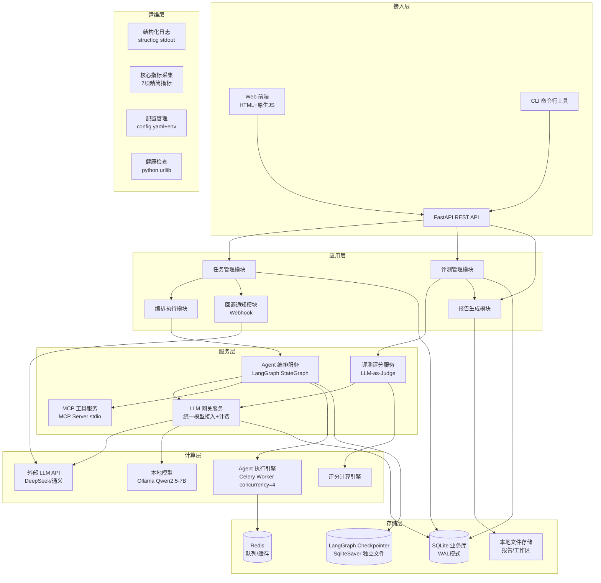
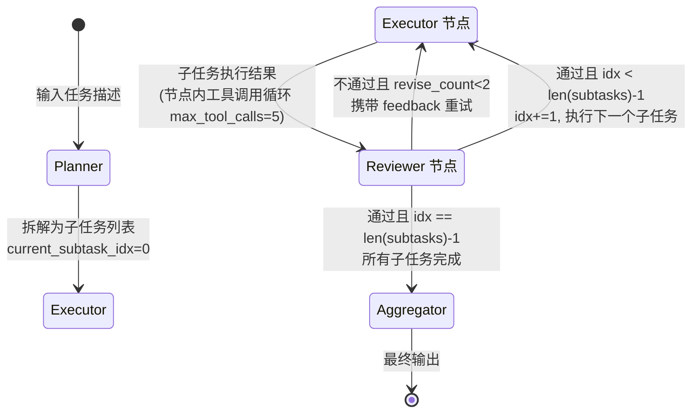
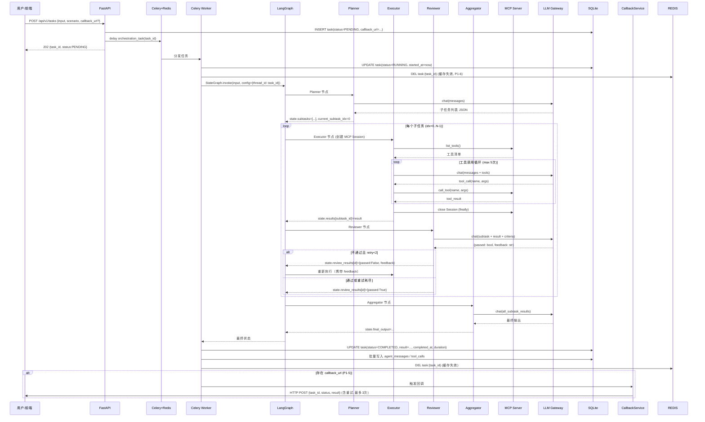
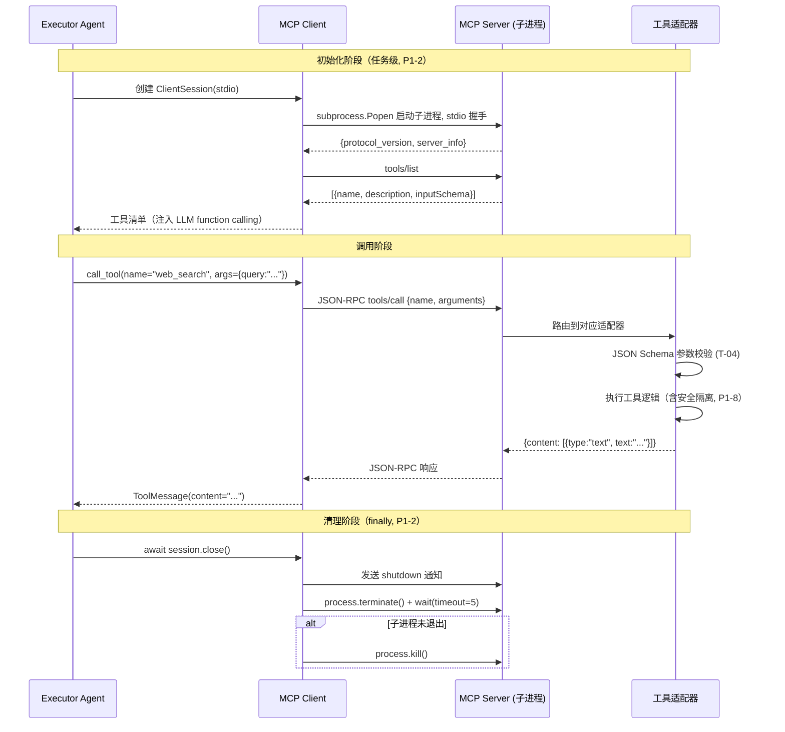
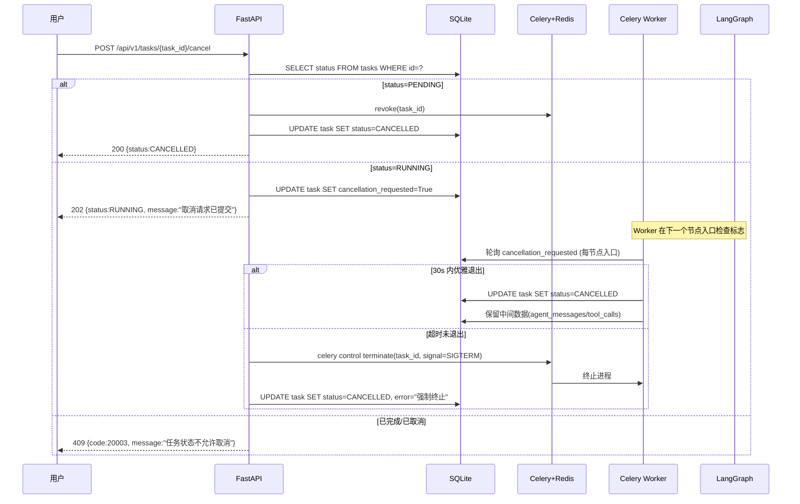
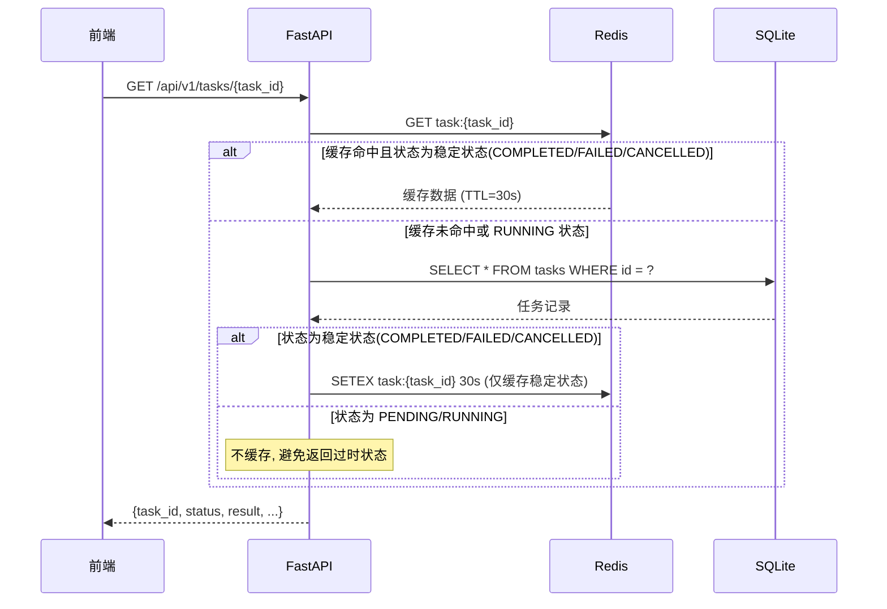
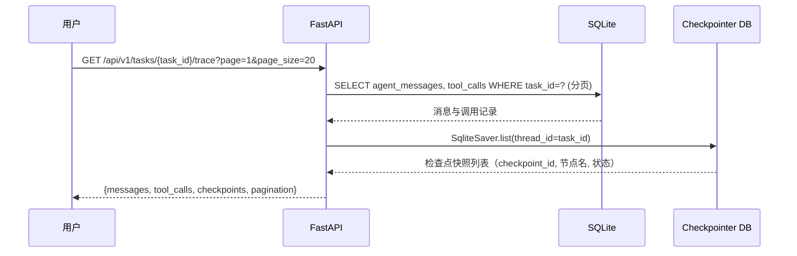
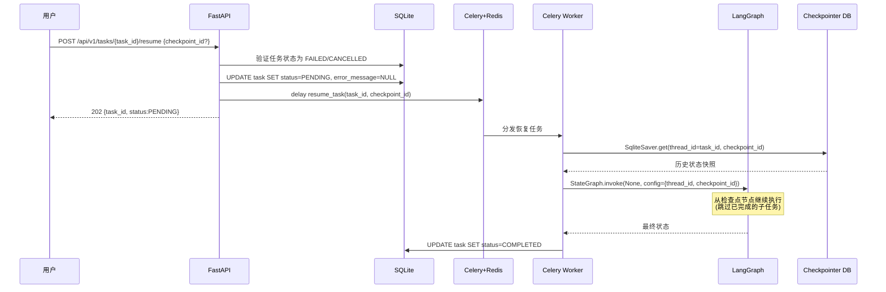
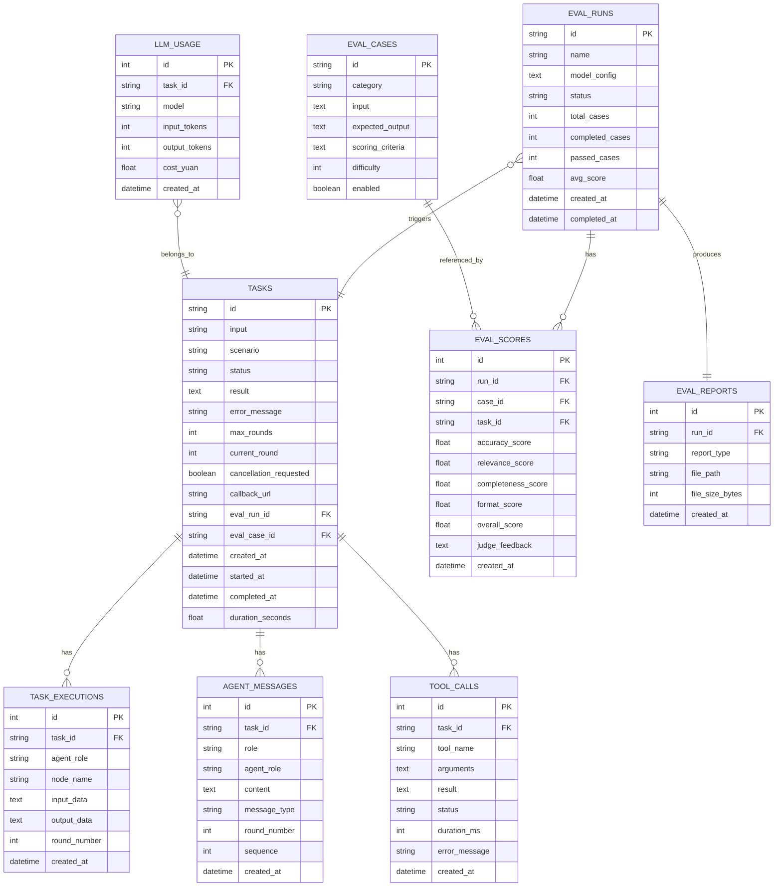

# 《第二轮技术架构设计文档》

**项目名称**：多智能体编排与模型评测一体化平台
**文档版本**：v2.0（第二轮，评审修正版）
**基线依据**：《项目基线说明书》v1.0（2026-10-05）
**评审依据**：《第一轮架构评审报告》v1.0（2026-10-05）
**设计日期**：2026-10-05
**文档状态**：评审通过版

---

## 修订说明：第一轮评审问题修正对照

本轮设计针对第一轮评审报告中的 **21 项问题**（P0×1 / P1×10 / P2×10）逐项修正，修正状态如下：

| 编号 | 问题摘要 | 严重度 | 修正状态 | 对应章节 |
|---|---|---|---|---|
| P0-1 | 评测并发模型未定义，存在死锁与性能不达标风险 | P0 | **已修正**：采用用例级任务拆分、无嵌套等待方案 | §3.3、§3.6 |
| P1-1 | LangGraph 状态图缺少子任务遍历条件边 | P1 | **已修正**：补全 current_subtask_idx 与条件路由 | §3.1.1 |
| P1-2 | MCP stdio Session 在 Celery 多进程下生命周期未定义 | P1 | **已修正**：任务级 Session + try/finally + 子进程终止 | §3.2.3 |
| P1-3 | Windows 开发环境与 Celery 5.x 兼容性未明确 | P1 | **已修正**：所有环境强制 docker-compose，提供 solo 降级方案 | §1.3、§6.6 |
| P1-4 | 任务取消（cancel）机制未设计 | P1 | **已修正**：三态取消语义 + 优雅退出 + 强制终止 | §3.4 |
| P1-5 | 结果回调（Webhook）缺失 | P1 | **已修正**：任务提交时接受 callback_url，完成后异步回调（含重试） | §3.5、§5.4.1 |
| P1-6 | 任务状态 Redis 缓存无主动失效机制 | P1 | **已修正**：Worker 状态变更后 DEL 缓存键，RUNNING 不缓存 | §3.7 |
| P1-7 | web_search 工具实现方案缺失，与"不依赖付费 SaaS"冲突 | P1 | **已修正**：DuckDuckGo HTML 抓取 + BeautifulSoup，免费无 Key | §1.2.4 |
| P1-8 | code_exec 工具安全隔离未设计 | P1 | **已修正**：临时目录 + 超时 + 内存限制 + 危险操作过滤 | §1.2.4 |
| P1-9 | LLM 费用预算控制的计算与持久化未明确 | P1 | **已修正**：LLMGateway 计费 + llm_usage 表持久化 + ¥180 阈值强制 Mock | §3.8、§4.2.9 |
| P1-10 | LangGraph 检查点"恢复"与"回放"混淆 | P1 | **已修正**：区分回放（只读 trace）与恢复（POST resume 重新执行） | §3.9 |
| P2-1 | Celery Beat 非核心，增加复杂度 | P2 | **已采纳**：移除 Beat，清理改为 CLI/API 触发 | §6.2 |
| P2-2 | Docker 健康检查依赖 curl（slim 镜像无 curl） | P2 | **已采纳**：改用 python urllib 健康检查 | §6.3 |
| P2-3 | trace 接口返回全量数据无分页 | P2 | **已采纳**：增加 page/page_size，按 round_number 分段 | §5.4.1 |
| P2-4 | Prometheus 23 个指标过度设计 | P2 | **已采纳**：精简至 7 个核心指标 | §7.1 |
| P2-5 | 三环境配置过重 | P2 | **已采纳**：单一 config.yaml + 环境变量覆盖 | §6.6 |
| P2-6 | Alembic 迁移对早期项目过重 | P2 | **已采纳**：开发期 create_all()，第 4 周表结构稳定后引入 Alembic | §4.6 |
| P2-7 | 18 个 API 端点远超需求 | P2 | **已采纳**：核心 10 个，其余 6 个标记 P2 延后 | §5.4 |
| P2-8 | init-cases 幂等性未说明 | P2 | **已采纳**：INSERT OR IGNORE 基于 case_id 主键 | §7.3.1 |
| P2-9 | 前端轮询无 SSE/WebSocket | P2 | **已采纳**：本期保留轮询，标注后续 SSE 优化方向 | §2.2.1 |
| P2-10 | 日志双输出在 Docker 下冗余 | P2 | **已采纳**：Docker 环境仅 stdout，文件输出可配置开关 | §7.4 |

---

## 目录

1. [技术选型说明](#1-技术选型说明)
2. [整体分层架构](#2-整体分层架构)
3. [核心业务链路](#3-核心业务链路)
4. [数据模型设计](#4-数据模型设计)
5. [接口规范定义](#5-接口规范定义)
6. [部署架构设计](#6-部署架构设计)
7. [监控与运维](#7-监控与运维)
8. [技术风险与应对方案](#8-技术风险与应对方案)

---

## 1. 技术选型说明

### 1.1 选型总览

| 层级 | 组件 | 选定版本 | 许可证 | 选型理由 | 基线对应 |
|---|---|---|---|---|---|
| 编排引擎 | LangGraph | 0.2.x | MIT | 基线硬约束；原生支持状态图、检查点、条件边，多 Agent 编排事实标准 | C-01 |
| LLM 抽象 | LangChain | 0.3.x | MIT | 与 LangGraph 同生态，统一 LLM/工具/消息接口，降低模型切换成本 | — |
| 工具协议 | MCP Python SDK | 0.1.x | MIT | 基线硬约束；Anthropic 开放协议，工具即插即用 | C-02 |
| Web 框架 | FastAPI | 0.115.x | MIT | 异步高性能、自动 OpenAPI 文档、Pydantic v2 数据校验 | C-04 |
| 任务队列 | Celery | 5.4.x | BSD-3 | 行业标准异步任务框架，支持重试、超时、结果后端；**已移除 Beat**（P2-1） | C-04 |
| 消息代理 | Redis | 7.4.x | BSD-3 | Celery broker，兼作缓存；docker-compose 一键启动 | — |
| 关系数据库 | SQLite | 3.45+（Python 内置） | Public Domain | 基线硬约束；零配置单文件，WAL 模式支持并发读写 | 全模块 |
| ORM | SQLAlchemy | 2.0.x | MIT | 异步 ORM，类型安全 Mapped 列，与 FastAPI 无缝集成 | — |
| 前端 | 纯 HTML + 原生 JS（ES6+） | — | — | 基线约束不引入重型框架；FastAPI 静态文件托管，零构建 | P-01 |
| 配置管理 | Pydantic Settings | 2.5.x | MIT | 类型安全配置，**单一 config.yaml + 环境变量覆盖**（P2-5） | P-04 |
| 结构化日志 | structlog | 24.4.x | MIT/Apache-2.0 | JSON 结构化日志，trace_id 透传；**Docker 下仅 stdout**（P2-10） | — |
| 网页搜索 | requests + BeautifulSoup4 | 2.32.x / 4.12.x | Apache-2.0 / MIT | **DuckDuckGo HTML 抓取**，免费无 API Key（P1-7） | T-01 |
| 测试框架 | pytest | 8.3.x | MIT | Python 事实标准测试框架 | S-01 |
| 覆盖率 | pytest-cov | 5.0.x | MIT | 行覆盖率统计，满足 ≥60% | S-01 |
| 容器化 | Docker + docker-compose | 24.x / 2.20+ | Apache-2.0 | 基线要求一键启动；**所有环境强制容器化**（P1-3） | S-04 |
| 代码规范 | Ruff | 0.6.x | MIT | lint + format 一体化 | — |
| 类型检查 | mypy | 1.11.x | MIT | 静态类型检查 | — |

> **变更说明**：相比第一轮，移除了 Celery Beat、Alembic（延后引入）、prometheus-client（精简指标后用轻量自实现）；新增 requests + BeautifulSoup4 作为 web_search 实现依赖。

### 1.2 关键选型决策说明

#### 1.2.1 为什么用 Celery + Redis 而非 FastAPI BackgroundTasks

基线要求任务支持"异步提交、状态轮询、结果回调"，且单任务 P95 ≤ 90s。BackgroundTasks 存在三个硬伤：

1. **进程耦合**：API 进程重启则在途任务丢失，无法满足 M-04（状态可追溯）
2. **无持久化队列**：高并发提交时任务积压在内存，无削峰能力
3. **无重试/超时控制**：Agent 任务涉及外部 LLM API，网络波动时需自动重试

Celery + Redis 以额外一个容器的代价，获得持久化队列、自动重试、超时控制、任务状态持久化。该方案不违反"单机部署"约束（X-01 排除的是 K8s 多节点，非单机多进程）。

#### 1.2.2 为什么用 SQLAlchemy 而非直接 sqlite3

- **异步支持**：SQLAlchemy 2.0 的 asyncio 引擎与 FastAPI 异步生态一致
- **类型安全**：Mapped 列定义配合 mypy，减少运行时字段错误
- **可移植性**：未来迁移 PostgreSQL 仅改连接串
- **迁移管理**：第 4 周表结构稳定后引入 Alembic（P2-6），开发期用 `create_all()`

#### 1.2.3 LLM 后端选型

| 后端 | 用途 | 接入方式 | 计费单价（元/1K tokens） |
|---|---|---|---|
| DeepSeek API（默认） | 开发与评测主推理后端 | OpenAI 兼容接口，langchain-openai 适配 | 输入 ¥0.001 / 输出 ¥0.002 |
| 通义千问（备选） | 模型对比评测 | OpenAI 兼容接口（DashScope 兼容模式） | 按模型配置 |
| Ollama + Qwen2.5-7B（可选） | 本地离线推理 | langchain-ollama 适配 | ¥0（本地） |
| Mock 模式 | 开发调试 / 预算耗尽后降级 | 预设响应模板 | ¥0 |

所有 LLM 调用通过统一的 `LLMGateway` 服务抽象，切换后端仅需修改配置。**费用计算与预算控制见 §3.8（P1-9 修正）**。

#### 1.2.4 MCP 工具实现方式（P1-7 / P1-8 修正）

采用 **MCP Server 独立进程 + stdio 传输**模式：

- MCP Server 作为独立 Python 进程运行，通过 stdio/stdout JSON-RPC 与 Agent 通信
- 工具适配器以插件形式注册，新增工具仅需编写一个函数 + JSON Schema 描述（满足 T-03：≤50 行）
- Agent 侧通过 `mcp` Python SDK 的 `ClientSession` 动态发现工具列表并调用

**首批 4 个工具及实现方案**：

| 工具名 | 功能 | 实现方案 | 安全措施 |
|---|---|---|---|
| `web_search` | 网页搜索 | **DuckDuckGo HTML 抓取 + BeautifulSoup 解析**（P1-7）：requests 请求 DuckDuckGo 搜索结果页，BS4 提取标题/链接/摘要，返回 Top 5。免费、无需 API Key、不依赖付费 SaaS | 请求超时 10s，User-Agent 伪装，结果缓存 5 分钟 |
| `code_exec` | 代码执行 | `subprocess.run` 在临时目录执行 Python 代码（P1-8） | ① 临时目录 `/tmp/code_exec_{uuid}/`，禁止挂载敏感路径；② 执行超时 10s（`timeout` 参数）；③ 内存限制通过 `resource.setrlimit`（Linux）/ 进程超时兜底；④ 危险操作过滤：禁止 `os.remove`、`shutil.rmtree`、环境变量读取、`socket` 网络操作；⑤ 声明为"可信本地环境"模式，API 暴露时需额外加固 |
| `file_read_write` | 文件读写 | 限定工作目录 `data/workspace/` 内的文件读写 | 路径白名单校验，禁止 `..` 穿越，单文件 ≤ 1MB |
| `db_query` | 数据库查询 | 只读 SQL 查询，连接业务 SQLite 库 | 仅允许 SELECT 语句，禁止 INSERT/UPDATE/DELETE/DROP，查询超时 5s，结果行数上限 1000 |

**工具适配器接口规范**：

```python
class ToolAdapter(Protocol):
    name: str
    description: str
    input_schema: dict  # JSON Schema

    async def execute(self, **kwargs) -> str:
        """执行工具，返回文本结果"""
        ...
```

新增工具只需实现该 Protocol 并在 `tools/registry.py` 注册，无需修改 Agent 核心代码（满足 T-03）。

### 1.3 兼容性说明（P1-3 修正）

| 维度 | 兼容范围 | 说明 |
|---|---|---|
| Python | 3.10 / 3.11 / 3.12 | 基线要求 ≥3.10；CI 矩阵覆盖 3.10 和 3.12 |
| OS 开发机 | Windows 10/11、Ubuntu 22.04+、macOS 13+ | **所有环境必须通过 docker-compose 运行**（P1-3），不支持 Windows 本机直接运行 Celery |
| OS 运行时 | Linux（Docker 容器） | 生产/演示环境统一 Linux 容器，消除跨 OS 差异 |
| LLM API | OpenAI 兼容协议（/v1/chat/completions） | DeepSeek、通义千问、Ollama 均兼容 |
| 浏览器 | Chrome 120+、Edge 120+、Firefox 121+ | 前端使用 ES6+ Fetch API，不依赖构建工具 |
| Docker | Engine ≥ 24.0，Compose ≥ 2.20 | 确保多阶段构建和健康检查支持 |

**Windows 降级方案**（仅当 Docker Desktop 不可用时）：
- API 服务：`uvicorn app.main:app --reload` 可在 Windows 本机运行
- Celery Worker：`celery -A app.worker worker --pool=solo --concurrency=1`（solo 模式，单任务串行，仅用于调试，不满足并发需求）
- **声明**：Windows 本机 solo 模式不支持并发评测，正式开发与演示必须使用 Docker

---

## 2. 整体分层架构

### 2.1 架构总览图



### 2.2 各层职责与组件

#### 2.2.1 接入层

| 组件 | 职责 | 技术实现 |
|---|---|---|
| Web 前端 | 任务提交表单、状态实时展示、评测报告可视化、工具列表查看 | 单页 HTML + 原生 JS，**Fetch API 轮询**（P2-9：本期保留轮询，后续可优化为 SSE，FastAPI 原生支持），FastAPI 静态文件托管 |
| REST API | 统一 HTTP 入口，请求校验、鉴权、路由分发、异步任务提交 | FastAPI 0.115，Pydantic v2 请求/响应模型 |
| CLI 工具 | 本地一键评测、任务提交、报告导出、数据清理（替代 Celery Beat，P2-1） | Typer 0.12，与 API 共享服务层代码 |

#### 2.2.2 应用层

| 模块 | 职责 | 核心类/函数 |
|---|---|---|
| 任务管理模块 | 任务创建、状态流转、结果持久化、列表查询、取消、恢复 | `TaskService`、`TaskStatus` 枚举 |
| 编排执行模块 | 调用 LangGraph 执行多 Agent 编排，管理执行生命周期 | `OrchestrationService`、`LangGraphRunner` |
| 评测管理模块 | 评测用例加载、评测运行调度（用例级任务拆分）、评分汇总 | `EvalService`、`EvalCaseLoader` |
| 报告生成模块 | 评测结果聚合、HTML/JSON 报告渲染、文件导出 | `ReportGenerator`、Jinja2 模板 |
| 回调通知模块 | 任务完成/失败后异步 HTTP Webhook 回调（P1-5），含重试机制 | `CallbackService`、httpx 异步客户端 |

#### 2.2.3 服务层

| 服务 | 职责 | 关键设计 |
|---|---|---|
| Agent 编排服务 | 定义 LangGraph StateGraph，管理 Planner/Executor/Reviewer/Aggregator 四角色协作，状态检查点持久化 | 状态图见 §3.1.1（P1-1 补全子任务遍历）；SqliteSaver 做检查点 |
| MCP 工具服务 | 独立 MCP Server 进程，注册 ≥4 个工具，提供工具发现与调用 | stdio 传输；**任务级 Session 生命周期管理**（P1-2，见 §3.2.3） |
| LLM 网关服务 | 统一 LLM 调用入口，模型路由、超时重试、Token 计数、**费用计算与预算控制**（P1-9） | `LLMGateway` 抽象类；配置驱动切换；llm_usage 表持久化 |
| 评测评分服务 | LLM-as-Judge 多维度评分，评分计算与一致性校验 | 4 维度评分器；temperature=0；双次评分取平均 |

#### 2.2.4 计算层

| 组件 | 职责 |
|---|---|
| 外部 LLM API | 默认推理后端（DeepSeek），处理 Agent 对话与 Judge 评分 |
| 本地模型（Ollama） | 可选离线推理后端，功能等价于 API 模型（P-02） |
| Agent 执行引擎 | Celery Worker 进程，**concurrency=4**，全部用于执行 Agent 任务（含评测用例任务），无嵌套等待（P0-1） |
| 评分计算引擎 | 对 LLM-as-Judge 返回的分数进行聚合、百分位计算、一致性校验 |

#### 2.2.5 存储层

| 存储 | 职责 | 数据内容 |
|---|---|---|
| SQLite（业务库） | 业务数据持久化，**WAL 模式 + busy_timeout=5000ms** | 任务、执行记录、Agent 消息、工具调用、评测用例、评测运行、评分、报告元数据、LLM 用量 |
| LangGraph Checkpointer | 编排状态检查点，独立文件 `data/checkpoints/checkpoints.db` | StateGraph 每个节点的状态快照，支持回放与恢复 |
| 本地文件存储 | 大文件与报告 | 评测报告 HTML/JSON、任务输出附件、code_exec 临时工作区 |
| Redis | 消息队列与缓存 | Celery 任务队列、任务状态缓存（**主动失效机制**，P1-6） |

#### 2.2.6 运维层

| 组件 | 职责 |
|---|---|
| 结构化日志 | 全链路 trace_id 透传，JSON 格式，**Docker 环境仅 stdout**（P2-10），文件输出可配置开关 |
| 核心指标采集 | **7 项精简指标**（P2-4）：任务数、完成率、耗时分布、LLM 调用数、工具调用成功率、评测平均分、队列长度 |
| 配置管理 | **单一 config.yaml + 环境变量覆盖**（P2-5），Pydantic Settings 原生支持，敏感信息不入库 |
| 健康检查 | `/health` 端点检查 DB/Redis/LLM 连通性，**python urllib 实现**（P2-2，不依赖 curl） |

### 2.3 层间通信规则

- **接入层 → 应用层**：同步调用，FastAPI 依赖注入获取 Service 实例
- **应用层 → 服务层**：同步调用（短操作）或 Celery 异步任务（长操作）
- **服务层 → 计算层**：LLM 调用通过 `LLMGateway` 统一出口，禁止 Service 直接调用 SDK
- **服务层 → 存储层**：通过 SQLAlchemy Repository 模式访问，禁止 Service 直接写 SQL
- **跨层调用**：禁止跳层（如 API 直接访问 DB），必须经过 Service 层
- **回调方向**：应用层 CallbackService → 外部 Webhook（HTTP POST），不经过服务层

---

## 3. 核心业务链路

### 3.1 多 Agent 任务执行链路（核心链路）

#### 3.1.1 状态图定义（P1-1 修正：补全子任务遍历）

**LangGraph State 定义**：

```python
class SubTask(TypedDict):
    id: str
    title: str
    description: str
    depends_on: list[str]  # 依赖的子任务 id

class ReviewResult(TypedDict):
    passed: bool
    feedback: str

class AgentState(TypedDict):
    input: str                          # 原始任务描述
    subtasks: list[SubTask]             # Planner 拆解的子任务列表
    current_subtask_idx: int            # 当前执行的子任务索引（P1-1 新增）
    results: dict[str, str]             # 子任务 id → 执行结果
    review_results: dict[str, ReviewResult]  # 子任务 id → 审查结果
    revise_count: dict[str, int]        # 子任务 id → 已重试次数
    final_output: str                   # 最终汇总输出
    max_tool_calls: int                 # 单节点最大工具调用次数，默认 5
```

**状态图（含子任务遍历条件边）**：



**条件边逻辑**（`after_reviewer` 函数）：

```python
def after_reviewer(state: AgentState) -> str:
    idx = state["current_subtask_idx"]
    current_id = state["subtasks"][idx]["id"]
    review = state["review_results"].get(current_id)

    # 不通过且未达重试上限 → 回到 Executor 重试
    if review and not review["passed"] and state["revise_count"].get(current_id, 0) < 2:
        state["revise_count"][current_id] = state["revise_count"].get(current_id, 0) + 1
        return "executor"

    # 通过（或重试耗尽强制通过）→ 判断是否还有下一个子任务
    if idx < len(state["subtasks"]) - 1:
        state["current_subtask_idx"] = idx + 1
        return "executor"  # 执行下一个子任务
    else:
        return "aggregator"  # 所有子任务完成，进入汇总
```

**关键设计决策**：
- **Executor 节点内工具调用循环**：工具调用（LLM 决策 → MCP 调用 → 结果回填）是 **Executor 节点内部的 while 循环**（`max_tool_calls=5`），不是图上边循环。节点入口时创建 MCP Session，节点出口时关闭（见 §3.2.3）。
- **重试耗尽策略**：Reviewer 不通过最多重试 2 次，第 3 次强制标记为通过并记录 warning，避免死循环。
- **current_subtask_idx**：P1-1 新增字段，确保子任务逐个遍历，不会只执行第一个就汇总。

**四个 Agent 角色定义**：

| 角色 | 职责 | 系统提示词核心 | 可调用工具 |
|---|---|---|---|
| Planner | 任务拆解、子任务排序、依赖分析 | "你是任务规划专家，将复杂任务拆解为可独立执行的子任务，输出 JSON 格式" | 无（纯推理） |
| Executor | 执行单个子任务，调用 MCP 工具获取信息 | "你是执行专家，使用可用工具完成子任务，必要时多次调用工具" | 全部 MCP 工具 |
| Reviewer | 审查执行结果，判断是否满足子任务目标 | "你是质量审查员，检查结果是否准确、完整、符合要求，输出 {passed, feedback}" | 无（纯推理） |
| Aggregator | 汇总所有子任务结果，生成最终输出 | "你是汇总专家，整合各子任务结果为连贯的最终答案" | 无（纯推理） |

#### 3.1.2 端到端调用时序



#### 3.1.3 各节点输入/处理/输出明细

| 节点 | 输入 | 处理逻辑 | 输出 |
|---|---|---|---|
| **API 提交** | `{input: str, scenario: str?, max_rounds: int?, callback_url: str?}` | 校验输入 → 创建 DB 记录 → 投递 Celery 任务 → 返回 202 | `{task_id: str, status: "PENDING"}` |
| **Planner** | `state.input` | LLM 推理 → 解析 JSON 子任务列表 → 写入 state.subtasks，重置 current_subtask_idx=0 | `state.subtasks: List[SubTask]` |
| **Executor** | `state.subtasks[current]`、`state.tools` | 创建 MCP Session → 循环：LLM 决策调工具 → MCP 调用 → 结果回填 → 直到 LLM 输出最终答案或达到 max_tool_calls(=5) → finally 关闭 Session | `state.results[subtask_id]: str` |
| **Reviewer** | `state.subtasks[current]`、`state.results[subtask_id]` | LLM 按评分标准判断 passed/fail → 不通过生成 feedback → 写入 review_results | `state.review_results[subtask_id]: ReviewResult` |
| **条件路由** | `state.current_subtask_idx`、review_results、revise_count | ① 不通过且 retry<2 → Executor（重试）② 通过且 idx<N-1 → idx+=1, Executor（下一子任务）③ 通过且 idx=N-1 → Aggregator | 路由目标节点名 |
| **Aggregator** | `state.results`（全部子任务结果） | LLM 整合为连贯最终输出 | `state.final_output: str` |
| **结果持久化** | `state.final_output`、全量中间状态 | 写入 task 表 + 批量写入 agent_messages/tool_calls 表 → DEL Redis 缓存 | 任务状态更新为 COMPLETED |
| **回调通知** | `task.callback_url`、任务结果 | httpx 异步 POST 回调 → 失败指数退避重试（最多 3 次） | 回调响应（仅日志记录） |

### 3.2 MCP 工具调用链路

#### 3.2.1 调用时序



#### 3.2.2 工具适配器接口规范

```python
class ToolAdapter(Protocol):
    name: str
    description: str
    input_schema: dict  # JSON Schema

    async def execute(self, **kwargs) -> str:
        """执行工具，返回文本结果"""
        ...
```

新增工具只需实现该 Protocol 并在 `tools/registry.py` 注册，无需修改 Agent 核心代码（满足 T-03）。

#### 3.2.3 MCP Session 生命周期管理（P1-2 修正）

**核心原则：Session 为任务级，非全局单例。**

| 阶段 | 操作 | 实现细节 |
|---|---|---|
| **创建** | Celery 任务入口、Executor 节点首次调用工具前 | `ClientSession(stdioTransport(read, write))`，通过 `subprocess.Popen` 启动 MCP Server 子进程 |
| **使用** | Executor 节点内工具调用循环 | 同一 Session 复用，list_tools 仅调用一次缓存 |
| **关闭** | Executor 节点出口的 `finally` 块 | `await session.close()` → 发送 shutdown → `process.terminate()` → `wait(timeout=5)` → 未退出则 `process.kill()` |
| **异常清理** | 任务异常退出（LLM 超时、Worker kill） | Celery 任务 `after_return` 钩子 + `try/finally` 双重保障，确保子进程终止 |
| **进程泄漏监控** | 运维层 | 定期检查子进程数，超过阈值（如 >10）告警；Worker 启动时清理孤儿 MCP 进程 |

**禁止事项**：
- 禁止 Agent 代码中 `print()` 到 stdout（stdio 被 MCP 占用，会干扰 JSON-RPC 通信），统一用 `logging`
- 禁止全局单例 Session（多任务串话）
- 禁止在非 finally 块中关闭 Session（异常时泄漏）

### 3.3 评测执行链路（P0-1 修正：用例级任务拆分、无嵌套等待）

#### 3.3.1 并发模型核心设计

**采用方案：用例级任务拆分（无嵌套等待）**

| 决策项 | 方案 |
|---|---|
| 调用路径 | API 层直接为每条用例 `delay` 一个 Agent Celery 任务，**评测协调逻辑不占用 Worker** |
| 并发单元 | 每条评测用例 = 一个独立 Celery 任务（内部执行 LangGraph + Judge 评分） |
| 并发数 | Worker `concurrency=4`，即最多 4 个用例同时执行 |
| Worker 池 | 全部用于执行 Agent 任务（普通任务 + 评测用例任务共享同一池），无评测协调任务占用 |
| 进度跟踪 | `eval_runs.completed_cases` 由各用例任务完成后**原子递增**（`UPDATE ... SET completed_cases = completed_cases + 1`） |
| 死锁风险 | **无**：不存在任务嵌套等待，不存在"评测任务等子任务、子任务等空闲 Worker"的循环 |

**性能估算**（验证 E-04 ≤5 分钟）：
- 30 用例 ÷ 4 并发 = 7.5 批
- 单用例平均耗时：Agent 执行（Planner 1 次 + Executor 2-3 次 LLM + Reviewer 1 次 ≈ 15-25s）+ Judge 评分（1 次 LLM ≈ 3-5s）≈ 20-30s
- 总耗时 ≈ 7.5 × 25s ≈ 187s ≈ **3.1 分钟**，满足 ≤5 分钟
- 最坏情况（每用例 90s P95）：7.5 × 90s = 675s ≈ 11 分钟 → 此时可临时提升 concurrency 至 6（需 CPU 允许），或用 `--batch` 分批

#### 3.3.2 端到端流程

```mermaid
flowchart TD
    A[POST /api/v1/eval/runs] --> B[创建 eval_run 记录<br/>status=PENDING, total_cases=N]
    B --> C[加载启用的评测用例列表]
    C --> D{用例数 > 0?}
    D -->|否| Z[返回 400: 用例库为空]
    D -->|是| E[UPDATE eval_run status=RUNNING]
    E --> F[循环每条用例:<br/>delay eval_case_task(run_id, case_id)]
    F --> G[立即返回 202 {run_id, status:RUNNING}]

    subgraph Celery Worker 池 (concurrency=4)
        H1[用例任务 1]
        H2[用例任务 2]
        H3[用例任务 3]
        H4[用例任务 4]
        H5[用例任务 5...N]
    end

    H1 --> I1[执行 LangGraph 编排<br/>获取 Agent 输出]
    I1 --> J1[LLM-as-Judge 4维度评分]
    J1 --> K1[写入 eval_scores]
    K1 --> L1[原子递增 eval_runs.completed_cases<br/>UPDATE SET completed_cases=completed_cases+1]
    L1 --> M1{completed_cases == total_cases?}

    H2 & H3 & H4 & H5 --> I1

    M1 -->|否| N[任务结束, Worker 释放]
    M1 -->|是| O[最后一个完成的用例任务<br/>触发报告生成]
    O --> P[汇总统计: 均值/百分位/通过率]
    P --> Q[生成 HTML + JSON 报告]
    Q --> R[UPDATE eval_run status=COMPLETED]
    R --> S[报告可下载]

    U[用户轮询 GET /eval/runs/{run_id}] --> V[读取 eval_run 进度]
```

#### 3.3.3 用例任务内部流程

每个 `eval_case_task(run_id, case_id)` Celery 任务执行以下步骤：

| 步骤 | 操作 | 输入 | 输出 |
|---|---|---|---|
| 1 | 加载用例详情 | case_id | `{input, expected_output, scoring_criteria}` |
| 2 | 创建关联 task 记录 | run_id, case_id, input | task_id（status=PENDING） |
| 3 | 执行 LangGraph 编排 | task_id, input | Agent 输出（同 §3.1） |
| 4 | LLM-as-Judge 评分 | 用例输入、Agent 输出、scoring_criteria | 4 维度分数 + feedback |
| 5 | 写入 eval_scores | run_id, case_id, task_id, 分数 | 评分记录 |
| 6 | 原子递增 completed_cases | run_id | eval_runs 表更新 |
| 7 | 判断是否为最后一个 | completed_cases == total_cases | 若是则触发报告生成 |
| 8 | 任务结束 | — | Worker 释放 |

**SQLite 写并发控制**（P0-1 要求）：
- 业务库开启 WAL 模式（`PRAGMA journal_mode=WAL`），读写不互斥
- `busy_timeout=5000ms`，写冲突时等待而非立即报错
- `completed_cases` 原子递增使用单条 `UPDATE eval_runs SET completed_cases = completed_cases + 1 WHERE id = ?`，SQLite 单条写操作原子
- 评测场景 Worker concurrency 控制在 ≤4，避免过度竞争

### 3.4 任务取消链路（P1-4 修正）

#### 3.4.1 取消语义

| 任务状态 | 取消操作 | 结果 |
|---|---|---|
| **PENDING**（队列中未执行） | Celery `revoke(task_id)` | 状态置 CANCELLED，Worker 领取时跳过 |
| **RUNNING**（执行中） | ① 置 `cancellation_requested=True`（DB 字段）② LangGraph 各节点入口检查该标志 → 优雅退出 ③ 超时 30s 未退出 → `celery control terminate`（杀 Worker 进程） | 状态置 CANCELLED，中间数据保留 |
| **COMPLETED / FAILED / CANCELLED** | 不允许取消 | 返回 409 状态冲突 |

#### 3.4.2 取消时序



**取消后的中间数据清理策略**：
- `agent_messages`、`tool_calls`、`task_executions` 记录**保留**，用于调试和回放
- LangGraph 检查点保留，可通过 trace 接口查看取消前的执行路径
- 不自动删除任务记录，由用户手动清理或 CLI 批量清理

### 3.5 任务结果回调链路（P1-5 修正）

#### 3.5.1 回调注册

任务提交时通过 `callback_url` 可选字段注册回调：

```json
POST /api/v1/tasks
{
  "input": "调研 LangGraph 最新特性",
  "scenario": "research",
  "callback_url": "https://example.com/webhook/task-complete"
}
```

回调 URL 存储在 `tasks.callback_url` 字段。

#### 3.5.2 回调触发与重试

| 触发时机 | 回调载荷 | 重试策略 |
|---|---|---|
| 任务完成（COMPLETED） | `{task_id, status:"COMPLETED", result, completed_at, duration_seconds}` | 失败后指数退避：1s → 3s → 9s，最多 3 次 |
| 任务失败（FAILED） | `{task_id, status:"FAILED", error_message, completed_at}` | 同上 |
| 任务取消（CANCELLED） | `{task_id, status:"CANCELLED", completed_at}` | 同上 |

**回调实现**：
- `CallbackService` 使用 `httpx.AsyncClient` 发送 POST
- 超时 10s，非 2xx 响应视为失败
- 重试在 Celery 任务内同步执行（不另开任务，避免复杂度）
- 回调失败仅记录日志，不影响任务本身状态
- 回调请求头包含 `X-Task-Id` 和 `X-Signature`（可选 HMAC 签名，预留扩展）

### 3.6 评测并发模型与 Worker 池关系（P0-1 补充说明）

```mermaid
graph LR
    subgraph "Celery Worker 池 (concurrency=4)"
        W1[Worker 进程 1]
        W2[Worker 进程 2]
        W3[Worker 进程 3]
        W4[Worker 进程 4]
    end

    subgraph "Redis 队列"
        Q1[普通任务: orchestration_task]
        Q2[评测用例任务: eval_case_task x30]
    end

    Q1 --> W1
    Q2 --> W2
    Q2 --> W3
    Q2 --> W4

    Note over W1,W4: 所有 Worker 都执行 Agent 任务<br/>无评测协调任务占用<br/>无嵌套等待, 无死锁
```

**关键约束**：
- 评测运行创建后，**API 进程**负责投递 30 个用例任务（快速循环，<1s 完成），不占用 Worker
- 不存在"评测任务内 delay 子任务并 get() 等待"的反模式
- Worker 池 100% 用于执行实际的 Agent 编排 + Judge 评分
- 普通任务与评测用例任务共享同一队列，按 FIFO 执行；评测期间普通任务可能排队，可通过独立队列隔离（后续优化）

### 3.7 任务状态查询与缓存链路（P1-6 修正）



**缓存主动失效机制**（P1-6）：
- Worker 每次更新 tasks 表状态后（PENDING→RUNNING、RUNNING→COMPLETED/FAILED），立即执行 `DEL task:{task_id}`
- RUNNING/PENDING 状态**不写入缓存**，仅缓存终态（COMPLETED/FAILED/CANCELLED）
- 终态缓存 TTL=30s，失效后回源 DB
- 取消操作（cancellation_requested）后也执行 DEL

### 3.8 LLM 费用预算控制链路（P1-9 修正）

#### 3.8.1 计费流程

```mermaid
flowchart TD
    A[LLMGateway.chat 调用] --> B[调用外部 LLM API]
    B --> C[解析响应: input_tokens, output_tokens]
    C --> D[计算费用:<br/>input_tokens × 单价_in + output_tokens × 单价_out]
    D --> E[写入 llm_usage 表<br/>INSERT model, tokens, cost, timestamp]
    E --> F[查询累计费用:<br/>SELECT SUM(cost) FROM llm_usage WHERE date=today]
    F --> G{累计费用 > ¥180?}
    G -->|否| H[正常返回 LLM 响应]
    G -->|是| I[触发告警: 预算接近上限]
    I --> J{当前任务是否在途?}
    J -->|在途| K[继续完成当前任务, 仅告警]
    J -->|新任务| L[强制切换 Mock 模式<br/>返回预设响应]
```

#### 3.8.2 计费配置

| 模型 | 输入单价（元/1K tokens） | 输出单价（元/1K tokens） | 配置项 |
|---|---|---|---|
| deepseek-chat | ¥0.001 | ¥0.002 | `llm.providers.deepseek.pricing.input` |
| qwen-turbo | ¥0.003 | ¥0.006 | `llm.providers.qwen.pricing.input` |
| ollama-local | ¥0 | ¥0 | 本地模型不计费 |
| mock | ¥0 | ¥0 | Mock 模式不计费 |

**持久化**：累计费用存储在 SQLite `llm_usage` 表（见 §4.2.9），容器重启不丢失。按天聚合，支持查询历史用量。

**阈值行为**：
- ¥180（90% 预算）：告警 + 新任务强制 Mock，在途任务继续
- ¥200（100% 预算）：所有新任务拒绝，返回 50003 错误码
- Mock 模式下评测仍可运行（使用预设响应），但评分结果仅供参考

### 3.9 检查点回放与恢复链路（P1-10 修正）

**区分两个概念**：

| 能力 | 说明 | 接口 | 语义 |
|---|---|---|---|
| **回放（Replay）** | 只读查看历史执行状态 | `GET /api/v1/tasks/{task_id}/trace` | 返回 agent_messages + tool_calls + 检查点快照列表，不重新执行 |
| **恢复（Resume）** | 从检查点重新执行 | `POST /api/v1/tasks/{task_id}/resume` | 从指定 checkpoint 重新 `StateGraph.invoke()`，任务状态置 RUNNING 继续 |

#### 3.9.1 回放链路



#### 3.9.2 恢复链路



**恢复限制**：
- 仅允许 FAILED / CANCELLED 状态的任务恢复，COMPLETED 任务返回 409
- `checkpoint_id` 可选，不传则从最新检查点恢复
- 恢复后任务重新进入正常执行流程（含回调通知）
- 恢复功能为 **P1 优先级**，本期实现基础版本；若时间紧张可降级为仅支持回放，恢复标记为后续优化

---

## 4. 数据模型设计

### 4.1 ER 关系图



### 4.2 核心表结构详细设计

#### 4.2.1 tasks（任务表）

| 字段名 | 类型 | 约束 | 说明 |
|---|---|---|---|
| `id` | VARCHAR(36) | PK | UUID v4，任务唯一标识 |
| `input` | TEXT | NOT NULL | 用户原始输入 |
| `scenario` | VARCHAR(64) | NOT NULL, DEFAULT 'default' | 场景标识（research / code_review / general） |
| `status` | VARCHAR(20) | NOT NULL, DEFAULT 'PENDING' | PENDING / RUNNING / COMPLETED / FAILED / CANCELLED |
| `result` | TEXT | NULLABLE | 最终输出内容 |
| `error_message` | TEXT | NULLABLE | 失败时的错误信息 |
| `max_rounds` | INTEGER | NOT NULL, DEFAULT 5 | 最大协作轮次（M-02 ≥5） |
| `current_round` | INTEGER | NOT NULL, DEFAULT 0 | 当前执行轮次 |
| `cancellation_requested` | BOOLEAN | NOT NULL, DEFAULT 0 | **P1-4 新增**：取消请求标志，Worker 节点入口检查 |
| `callback_url` | VARCHAR(512) | NULLABLE | **P1-5 新增**：任务完成回调 URL |
| `eval_run_id` | VARCHAR(36) | NULLABLE, FK → eval_runs.id | 关联评测运行（评测用例任务时填充） |
| `eval_case_id` | VARCHAR(36) | NULLABLE, FK → eval_cases.id | 关联评测用例 |
| `created_at` | DATETIME | NOT NULL | 创建时间（UTC） |
| `started_at` | DATETIME | NULLABLE | 开始执行时间 |
| `completed_at` | DATETIME | NULLABLE | 完成时间 |
| `duration_seconds` | FLOAT | NULLABLE | 执行耗时（P50/P95 统计） |

**索引**：
- `idx_tasks_status` ON `(status)` — 状态筛选
- `idx_tasks_created_at` ON `(created_at DESC)` — 按时间排序
- `idx_tasks_scenario` ON `(scenario)` — 场景筛选
- `idx_tasks_eval_run` ON `(eval_run_id)` — 按评测运行筛选

#### 4.2.2 task_executions（任务执行记录表）

| 字段名 | 类型 | 约束 | 说明 |
|---|---|---|---|
| `id` | INTEGER | PK, AUTOINCREMENT | 自增主键 |
| `task_id` | VARCHAR(36) | FK → tasks.id, NOT NULL | 关联任务 |
| `agent_role` | VARCHAR(20) | NOT NULL | planner / executor / reviewer / aggregator |
| `node_name` | VARCHAR(64) | NOT NULL | LangGraph 节点名 |
| `input_data` | TEXT | NOT NULL | 节点输入（JSON） |
| `output_data` | TEXT | NULLABLE | 节点输出（JSON） |
| `round_number` | INTEGER | NOT NULL, DEFAULT 1 | 第几轮协作 |
| `created_at` | DATETIME | NOT NULL | 执行时间 |

**索引**：`idx_exec_task_id` ON `(task_id, round_number)`

#### 4.2.3 agent_messages（Agent 间消息表）

| 字段名 | 类型 | 约束 | 说明 |
|---|---|---|---|
| `id` | INTEGER | PK, AUTOINCREMENT | 自增主键 |
| `task_id` | VARCHAR(36) | FK → tasks.id, NOT NULL | 关联任务 |
| `role` | VARCHAR(20) | NOT NULL | system / user / assistant / tool |
| `agent_role` | VARCHAR(20) | NULLABLE | 发送方 Agent 角色 |
| `content` | TEXT | NOT NULL | 消息内容 |
| `message_type` | VARCHAR(20) | NOT NULL, DEFAULT 'text' | text / tool_call / tool_result |
| `round_number` | INTEGER | NOT NULL, DEFAULT 1 | 协作轮次 |
| `sequence` | INTEGER | NOT NULL | 轮次内消息序号 |
| `created_at` | DATETIME | NOT NULL | 消息时间 |

**索引**：`idx_messages_task_round` ON `(task_id, round_number, sequence)`

#### 4.2.4 tool_calls（工具调用记录表）

| 字段名 | 类型 | 约束 | 说明 |
|---|---|---|---|
| `id` | INTEGER | PK, AUTOINCREMENT | 自增主键 |
| `task_id` | VARCHAR(36) | FK → tasks.id, NOT NULL | 关联任务 |
| `tool_name` | VARCHAR(64) | NOT NULL | MCP 工具名 |
| `arguments` | TEXT | NOT NULL | 调用参数（JSON） |
| `result` | TEXT | NULLABLE | 工具返回结果 |
| `status` | VARCHAR(20) | NOT NULL, DEFAULT 'SUCCESS' | SUCCESS / FAILED |
| `duration_ms` | INTEGER | NULLABLE | 调用耗时（毫秒） |
| `error_message` | TEXT | NULLABLE | 失败原因 |
| `created_at` | DATETIME | NOT NULL | 调用时间 |

**索引**：`idx_tool_calls_task` ON `(task_id)`、`idx_tool_calls_name` ON `(tool_name)`

#### 4.2.5 eval_cases（评测用例表）

| 字段名 | 类型 | 约束 | 说明 |
|---|---|---|---|
| `id` | VARCHAR(36) | PK | 用例 ID（如 case-001），**init-cases 时 INSERT OR IGNORE 基于此主键**（P2-8） |
| `category` | VARCHAR(64) | NOT NULL | 用例分类（research / code / general） |
| `input` | TEXT | NOT NULL | 用例输入 |
| `expected_output` | TEXT | NULLABLE | 期望输出（参考，非严格匹配） |
| `scoring_criteria` | TEXT | NOT NULL | 评分标准（注入 Judge 提示词） |
| `difficulty` | INTEGER | NOT NULL, DEFAULT 1 | 难度 1-5 |
| `enabled` | BOOLEAN | NOT NULL, DEFAULT 1 | 是否启用 |

**索引**：`idx_eval_cases_category` ON `(category, enabled)`

#### 4.2.6 eval_runs（评测运行表）

| 字段名 | 类型 | 约束 | 说明 |
|---|---|---|---|
| `id` | VARCHAR(36) | PK | 运行 ID |
| `name` | VARCHAR(128) | NOT NULL | 运行名称 |
| `model_config` | TEXT | NOT NULL | 模型配置快照（JSON） |
| `status` | VARCHAR(20) | NOT NULL, DEFAULT 'PENDING' | PENDING / RUNNING / COMPLETED / FAILED |
| `total_cases` | INTEGER | NOT NULL, DEFAULT 0 | 总用例数 |
| `completed_cases` | INTEGER | NOT NULL, DEFAULT 0 | 已完成用例数（**原子递增**，P0-1） |
| `passed_cases` | INTEGER | NOT NULL, DEFAULT 0 | 通过用例数（overall ≥ 6 视为通过） |
| `avg_score` | FLOAT | NULLABLE | 平均总分 |
| `created_at` | DATETIME | NOT NULL | 创建时间 |
| `completed_at` | DATETIME | NULLABLE | 完成时间 |

**索引**：`idx_eval_runs_status` ON `(status)`

#### 4.2.7 eval_scores（评测评分表）

| 字段名 | 类型 | 约束 | 说明 |
|---|---|---|---|
| `id` | INTEGER | PK, AUTOINCREMENT | 自增主键 |
| `run_id` | VARCHAR(36) | FK → eval_runs.id, NOT NULL | 关联评测运行 |
| `case_id` | VARCHAR(36) | FK → eval_cases.id, NOT NULL | 关联用例 |
| `task_id` | VARCHAR(36) | FK → tasks.id, NULLABLE | 关联的 Agent 任务 |
| `accuracy_score` | FLOAT | NOT NULL | 准确性 0-10 |
| `relevance_score` | FLOAT | NOT NULL | 相关性 0-10 |
| `completeness_score` | FLOAT | NOT NULL | 完整性 0-10 |
| `format_score` | FLOAT | NOT NULL | 格式合规性 0-10 |
| `overall_score` | FLOAT | NOT NULL | 总分（加权平均：accuracy 0.3 + relevance 0.3 + completeness 0.25 + format 0.15） |
| `judge_feedback` | TEXT | NULLABLE | Judge 文字反馈 |
| `created_at` | DATETIME | NOT NULL | 评分时间 |

**索引**：`idx_scores_run` ON `(run_id)`、`idx_scores_case` ON `(case_id)`

#### 4.2.8 eval_reports（评测报告表）

| 字段名 | 类型 | 约束 | 说明 |
|---|---|---|---|
| `id` | INTEGER | PK, AUTOINCREMENT | 自增主键 |
| `run_id` | VARCHAR(36) | FK → eval_runs.id, NOT NULL, UNIQUE | 关联运行 |
| `report_type` | VARCHAR(20) | NOT NULL | html / json |
| `file_path` | VARCHAR(512) | NOT NULL | 本地文件路径 |
| `file_size_bytes` | INTEGER | NOT NULL | 文件大小 |
| `created_at` | DATETIME | NOT NULL | 生成时间 |

#### 4.2.9 llm_usage（LLM 用量表，P1-9 新增）

| 字段名 | 类型 | 约束 | 说明 |
|---|---|---|---|
| `id` | INTEGER | PK, AUTOINCREMENT | 自增主键 |
| `task_id` | VARCHAR(36) | FK → tasks.id, NULLABLE | 关联任务（评测 Judge 调用可能无 task_id） |
| `model` | VARCHAR(64) | NOT NULL | 模型标识（deepseek-chat / qwen-turbo / ollama / mock） |
| `input_tokens` | INTEGER | NOT NULL, DEFAULT 0 | 输入 Token 数 |
| `output_tokens` | INTEGER | NOT NULL, DEFAULT 0 | 输出 Token 数 |
| `cost_yuan` | FLOAT | NOT NULL, DEFAULT 0 | 本次调用费用（元） |
| `created_at` | DATETIME | NOT NULL | 调用时间 |

**索引**：`idx_llm_usage_date` ON `(created_at)`、`idx_llm_usage_model` ON `(model)`

**用途**：
- 累计费用查询：`SELECT SUM(cost_yuan) FROM llm_usage WHERE date(created_at) = date('now')`
- 预算控制：超过 ¥180 告警 + 强制 Mock（见 §3.8）
- 成本分析：按模型/按任务统计 Token 消耗

### 4.3 字段规范

| 规范项 | 规则 |
|---|---|
| 主键 | 业务表用 VARCHAR(36) UUID v4；关联表/日志表用 INTEGER AUTOINCREMENT |
| 时间字段 | 统一 DATETIME，存储 UTC，命名 `xxx_at` |
| 状态字段 | VARCHAR(20)，大写蛇形（PENDING、RUNNING），应用层枚举校验 |
| 金额/分数 | FLOAT，评分统一 0-10 范围，费用单位元保留 4 位小数 |
| JSON 字段 | 用 TEXT 存储，应用层 Pydantic 模型序列化/反序列化 |
| 软删除 | 不使用软删除，数据直接 DELETE（评测/任务数据可重建） |
| 字符集 | SQLite 默认 UTF-8，确保中文存储正常 |
| 布尔值 | SQLite 用 INTEGER 0/1 存储，SQLAlchemy Boolean 类型自动转换 |

### 4.4 表关联关系汇总

| 主表 | 从表 | 关系 | 外键 | 级联策略 |
|---|---|---|---|---|
| tasks | task_executions | 1:N | task_id | ON DELETE CASCADE |
| tasks | agent_messages | 1:N | task_id | ON DELETE CASCADE |
| tasks | tool_calls | 1:N | task_id | ON DELETE CASCADE |
| tasks | llm_usage | 1:N | task_id | ON DELETE SET NULL |
| eval_runs | eval_scores | 1:N | run_id | ON DELETE CASCADE |
| eval_runs | eval_reports | 1:1 | run_id | ON DELETE CASCADE |
| eval_runs | tasks | 1:N | eval_run_id | ON DELETE SET NULL |
| eval_cases | eval_scores | 1:N | case_id | ON DELETE RESTRICT |
| eval_cases | tasks | 1:N | eval_case_id | ON DELETE SET NULL |

### 4.5 LangGraph 检查点存储

LangGraph 的 `SqliteSaver` 使用独立的 SQLite 文件（`data/checkpoints/checkpoints.db`），内部表结构由 LangGraph 管理（`checkpoints`、`checkpoint_writes`、`checkpoint_blobs`），不与业务库混用。通过 `thread_id = task_id` 关联业务任务。

- **回放**：`SqliteSaver.list(thread_id=task_id)` 获取所有检查点（P1-10）
- **恢复**：`StateGraph.invoke(None, config={"configurable": {"thread_id": task_id}, "checkpoint_id": ...})`（P1-10）

### 4.6 数据库迁移策略（P2-6 修正）

| 阶段 | 时间 | 策略 |
|---|---|---|
| 开发初期 | 第 1-3 周 | `SQLAlchemy create_all()` 自动建表，表结构频繁变动时直接删库重建 |
| 表结构稳定后 | 第 4 周起 | 引入 Alembic，生成初始 migration 脚本，后续变更通过 `alembic revision --autogenerate` 管理 |
| 交付时 | 第 6 周 | 提供初始 migration + 完整 schema，确保干净环境可复现 |

**理由**：项目初期表结构频繁变动，Alembic 迁移脚本维护成本高（尤其 SQLite 的 DDL 限制）；第 4 周核心模块完成后表结构基本稳定，此时引入 Alembic 性价比最高。

---

## 5. 接口规范定义

### 5.1 统一请求/返回格式

#### 5.1.1 成功响应

所有接口返回统一信封格式：

```json
{
  "code": 0,
  "message": "success",
  "data": { ... },
  "request_id": "req_abc123",
  "timestamp": "2026-10-05T12:00:00Z"
}
```

| 字段 | 类型 | 说明 |
|---|---|---|
| `code` | int | 业务状态码，0 表示成功，非 0 表示错误 |
| `message` | string | 状态描述 |
| `data` | object/array/null | 业务数据 |
| `request_id` | string | 请求唯一标识，用于日志追踪 |
| `timestamp` | string | 响应时间（ISO 8601 UTC） |

#### 5.1.2 分页响应

列表接口的 `data` 字段包含分页信息：

```json
{
  "code": 0,
  "message": "success",
  "data": {
    "items": [ ... ],
    "total": 100,
    "page": 1,
    "page_size": 20,
    "total_pages": 5
  },
  "request_id": "req_abc123",
  "timestamp": "2026-10-05T12:00:00Z"
}
```

分页参数：`page`（默认 1）、`page_size`（默认 20，最大 100）。

#### 5.1.3 错误响应

```json
{
  "code": 40001,
  "message": "任务输入不能为空",
  "data": null,
  "request_id": "req_abc123",
  "timestamp": "2026-10-05T12:00:00Z",
  "details": {
    "field": "input",
    "reason": "input is required"
  }
}
```

### 5.2 错误码规范

采用 5 位数字错误码，前 2 位为模块，后 3 位为具体错误：

| 错误码范围 | 模块 | HTTP 状态码 |
|---|---|---|
| 0 | 成功 | 200 |
| 10000-10999 | 通用/系统错误 | 500 |
| 20000-20999 | 任务模块错误 | 400 / 404 / 409 |
| 30000-30999 | 评测模块错误 | 400 / 404 |
| 40000-40999 | 工具/MCP 模块错误 | 400 / 502 |
| 50000-50999 | LLM 网关错误 | 502 / 504 / 429 |

**常用错误码**：

| 错误码 | message | HTTP | 说明 |
|---|---|---|---|
| 10001 | 内部服务器错误 | 500 | 未捕获异常 |
| 10002 | 请求参数校验失败 | 400 | Pydantic 校验失败 |
| 10003 | 资源不存在 | 404 | 通用 404 |
| 10004 | 请求过于频繁 | 429 | 限流 |
| 20001 | 任务输入不能为空 | 400 | input 字段为空 |
| 20002 | 任务不存在 | 404 | task_id 无效 |
| 20003 | 任务状态不允许该操作 | 409 | 如对已完成任务取消/恢复 |
| 20004 | 任务执行失败 | 500 | Worker 执行异常 |
| 20005 | 任务取消超时，已强制终止 | 200 | 取消时优雅退出超时 |
| 30001 | 评测用例库为空 | 400 | 无可用用例 |
| 30002 | 评测运行不存在 | 404 | run_id 无效 |
| 30003 | 报告尚未生成 | 404 | 评测未完成 |
| 40001 | MCP 工具不存在 | 400 | 工具名未注册 |
| 40002 | 工具参数校验失败 | 400 | JSON Schema 校验不通过 |
| 40003 | 工具执行超时 | 504 | 工具调用超时 |
| 50001 | LLM API 调用失败 | 502 | 外部 API 错误 |
| 50002 | LLM API 超时 | 504 | 超过超时阈值 |
| 50003 | LLM API 配额不足 | 429 | 触发预算保护（¥200 上限） |

### 5.3 鉴权规则

鉴于基线明确排除多租户/用户权限体系（X-02），采用**轻量级 API Key 机制**：

- 环境变量 `API_KEY` 配置一个全局密钥（可选，未设置则不鉴权）
- 客户端通过请求头 `X-API-Key: <key>` 传递
- 仅对写操作（POST/PUT/DELETE）强制鉴权，读操作（GET）开放
- 密钥不存入数据库，仅在内存中比对
- 预留 `AuthMiddleware` 扩展点，未来可替换为 JWT/OAuth

### 5.4 核心接口清单（P2-7 修正：精简至核心 10 个）

#### 5.4.1 任务管理接口（核心 7 个）

| 方法 | 路径 | 说明 | 优先级 | 请求体 | 响应 data |
|---|---|---|---|---|---|
| POST | `/api/v1/tasks` | 提交任务 | P0 | `{input: str, scenario: str?, max_rounds: int?, callback_url: str?}` | `{task_id, status}` |
| GET | `/api/v1/tasks/{task_id}` | 查询任务状态 | P0 | — | 任务详情（含状态、结果、耗时、进度） |
| GET | `/api/v1/tasks/{task_id}/result` | 获取任务结果 | P0 | — | `{task_id, result, status}` |
| GET | `/api/v1/tasks/{task_id}/trace` | 获取执行链路（**分页**，P2-3） | P0 | query: `page, page_size, round_number?` | `{messages, tool_calls, checkpoints, pagination}` |
| POST | `/api/v1/tasks/{task_id}/cancel` | 取消任务（P1-4） | P0 | — | `{task_id, status, message}` |
| POST | `/api/v1/tasks/{task_id}/resume` | 从检查点恢复任务（P1-10） | P1 | `{checkpoint_id: str?}` | `{task_id, status: PENDING}` |
| GET | `/api/v1/tasks` | 任务列表（分页） | P2 | query: `page, page_size, status?, scenario?` | 分页任务列表 |

**trace 接口分页说明**（P2-3）：
- 默认按 `round_number` 升序 + `sequence` 升序返回
- `page_size` 默认 20，最大 100
- 可通过 `round_number` 参数筛选特定轮次
- 返回 `checkpoints` 列表（checkpoint_id, 节点名, 时间戳），用于恢复接口

#### 5.4.2 评测管理接口（核心 3 个 + P2 延后 3 个）

| 方法 | 路径 | 说明 | 优先级 | 请求体 | 响应 data |
|---|---|---|---|---|---|
| POST | `/api/v1/eval/runs` | 触发评测（**用例级任务拆分**，P0-1） | P0 | `{name: str?, case_ids: [str]?, model_config: dict?}` | `{run_id, status: RUNNING, total_cases}` |
| GET | `/api/v1/eval/runs/{run_id}` | 评测运行状态（含进度） | P0 | — | 运行详情（含 completed_cases/total_cases, avg_score） |
| GET | `/api/v1/eval/runs/{run_id}/report` | 下载评测报告 | P0 | query: `format=html\|json` | 文件下载流 |
| GET | `/api/v1/eval/runs` | 评测运行列表 | P2 | query: `page, page_size` | 分页运行列表 |
| GET | `/api/v1/eval/runs/{run_id}/scores` | 评测评分明细 | P2 | query: `page, page_size` | 分页评分列表 |
| GET | `/api/v1/eval/cases` | 评测用例列表 | P2 | query: `page, page_size, category?, enabled?` | 分页用例列表 |

#### 5.4.3 系统接口（核心 1 个 + P2 延后 2 个）

| 方法 | 路径 | 说明 | 优先级 | 响应 data |
|---|---|---|---|---|
| GET | `/api/v1/health` | 健康检查（**python urllib**，P2-2） | P0 | `{status, db, redis, llm, version}` |
| GET | `/api/v1/metrics` | 核心指标（7 项精简，P2-4） | P2 | 文本格式指标 |
| GET | `/api/v1/tools` | 列出已注册 MCP 工具 | P2 | `[{name, description, input_schema}]` |

**接口统计**：核心实现 10 个（任务 6 + 评测 3 + 系统 1），P2 延后 6 个（任务列表 1 + 评测 3 + 系统 2）。满足基线 S-02（≥5 个端点），且避免过度开发。

### 5.5 OpenAPI 文档

FastAPI 自动生成：
- Swagger UI：`/docs`
- ReDoc：`/redoc`
- OpenAPI JSON：`/openapi.json`

所有接口的请求/响应模型通过 Pydantic 定义，自动生成文档，满足基线"API 文档（OpenAPI 格式）"交付要求。

---

## 6. 部署架构设计

### 6.1 部署拓扑

```mermaid
graph LR
    subgraph Docker Host（单机）
        subgraph docker-compose
            API[api-server<br/>FastAPI :8000]
            WORKER[celery-worker<br/>concurrency=4]
            REDIS[redis :6379<br/>队列/缓存]
            DB_VOL[data volume<br/>SQLite + 报告 + 检查点]
        end
        OLLAMA[ollama :11434<br/>可选, 本地模型]
    end

    USER[用户浏览器] -->|HTTP :8000| API
    API -->|任务投递| REDIS
    REDIS -->|任务分发| WORKER
    API -->|读写| DB_VOL
    WORKER -->|读写| DB_VOL
    WORKER -->|LLM 调用| EXT_API[外部 LLM API]
    WORKER -.->|可选本地推理| OLLAMA
```

> **变更说明**：相比第一轮，**移除了 celery-beat 容器**（P2-1），定时清理改为 CLI 命令手动执行或 API 触发。

### 6.2 docker-compose 服务定义

| 服务名 | 镜像 | 端口 | 依赖 | 说明 |
|---|---|---|---|---|
| `api` | 本地构建（python:3.12-slim） | 8000:8000 | redis | FastAPI 服务，托管前端静态文件 |
| `worker` | 同 api 镜像（command: `celery -A app.worker worker --concurrency=4 --loglevel=info`） | — | redis | Celery Worker，执行 Agent 编排任务，**concurrency=4**（P0-1） |
| `redis` | redis:7.4-alpine | 6379（仅内部） | — | Celery broker + 缓存，开启 AOF 持久化 |
| `ollama`（可选） | ollama/ollama:latest | 11434（仅内部） | — | 本地模型，通过 `--profile ollama` 选择性启动 |

**启动命令**：`docker-compose up -d`（满足 S-04 一键启动）

**可选本地模型启动**：`docker-compose --profile ollama up -d`

**数据卷**：
- `./data:/app/data`：SQLite 库、检查点、报告、日志（持久化到宿主机）

### 6.3 容器构建策略（P2-2 修正）

采用**多阶段构建**减小镜像体积：

```
Stage 1 (builder): python:3.12-slim → 安装依赖 → 编译
Stage 2 (runtime): python:3.12-slim → 拷贝 site-packages + 代码 → 非 root 用户运行
```

- 最终镜像目标 < 500MB
- 不安装开发依赖（pytest、ruff、mypy）
- **健康检查**（P2-2 修正）：
  ```dockerfile
  HEALTHCHECK --interval=30s --timeout=5s --retries=3 \
    CMD python -c "import urllib.request; urllib.request.urlopen('http://localhost:8000/api/v1/health')"
  ```
  不依赖 curl/wget，使用 Python 标准库 urllib。

### 6.4 高可用方案

基线 X-06 明确"生产级高可用/灾备"不在范围内，但设计上保留以下基础保障：

| 维度 | 方案 | 说明 |
|---|---|---|
| API 无状态 | FastAPI 实例无状态，可启动多个副本（`docker-compose up --scale api=3`） | 需前置负载均衡（如 nginx），默认单副本 |
| Worker 水平扩展 | Celery Worker 可多副本，`--concurrency` 控制单进程并发 | 默认 concurrency=4，可根据 CPU 调整 |
| 任务持久化 | Redis AOF 持久化 + SQLite 任务状态 | 容器重启不丢失任务 |
| 检查点恢复 | LangGraph SqliteSaver 持久化状态 | Worker 崩溃后可通过 `POST /tasks/{id}/resume` 恢复（P1-10） |
| 健康检查 | docker-compose healthcheck 自动重启异常容器 | `restart: unless-stopped` |
| 取消机制 | 支持 PENDING revoke + RUNNING 优雅退出 + 强制终止（P1-4） | 避免异常任务占用 Worker |

### 6.5 弹性扩缩容策略

单机部署下的"弹性"体现在配置层面：

| 场景 | 策略 | 配置方式 |
|---|---|---|
| 评测批量执行（30 用例并发） | Worker concurrency=4（默认），CPU 允许时可临时提升至 6 | `CELERY_WORKER_CONCURRENCY=6` 环境变量 + 重启 worker |
| API 高并发查询 | 增加 API 副本 | `docker-compose up --scale api=N` |
| 低峰期 / 内存不足 | 降低并发节省资源 | `CELERY_WORKER_CONCURRENCY=2` |
| 预算耗尽 | 自动切换 Mock 模式 | LLMGateway 检测 ¥180 阈值后强制 Mock（P1-9） |

### 6.6 环境划分（P1-3 / P2-5 修正）

**所有环境（含 dev）必须通过 docker-compose 运行**（P1-3），不支持 Windows 本机直接运行 Celery。

| 环境 | 用途 | 配置特点 | 数据 |
|---|---|---|---|
| **dev**（本地开发） | 开发者本机调试 | docker-compose 启动，代码挂载热重载（uvicorn --reload），Mock LLM 模式可切换 | 合成测试数据 |
| **test**（自动化测试） | CI/CD 单元测试 + 集成测试 | pytest 运行、临时 SQLite 文件、Mock 外部 API | 测试用例固定数据集 |
| **prod**（演示/交付） | 最终演示与交付 | docker-compose 启动、真实 LLM API、持久化数据卷 | 评测用例库 + 运行记录 |

**配置管理**（P2-5 修正）：
- 单一 `config.yaml` 文件作为基础配置
- 环境变量覆盖（Pydantic Settings 原生支持，`env_prefix="APP_"`）
- CI 中通过环境变量注入测试配置（如 `APP_DATABASE_URL=sqlite:///test.db`）
- 不再维护 dev/test/prod 三套 YAML 文件

**关键环境变量**：

| 变量 | 说明 | 默认值 |
|---|---|---|
| `APP_LLM_API_KEY` | LLM API 密钥（必填） | — |
| `APP_LLM_PROVIDER` | LLM 提供商（deepseek / qwen / ollama / mock） | deepseek |
| `APP_CELERY_CONCURRENCY` | Worker 并发数 | 4 |
| `APP_DATABASE_URL` | SQLite 连接串 | sqlite:///data/db/app.db |
| `APP_REDIS_URL` | Redis 连接串 | redis://redis:6379/0 |
| `APP_API_KEY` | API 鉴权密钥（可选） | 未设置则不鉴权 |
| `APP_LOG_TO_FILE` | 是否输出日志到文件（Docker 下默认 false） | false |
| `APP_BUDGET_LIMIT` | LLM 预算上限（元） | 200 |

### 6.7 数据卷与持久化

| 挂载路径 | 内容 | 备份策略 |
|---|---|---|
| `/app/data/db/` | SQLite 业务数据库文件 | CLI `backup` 命令手动执行（替代 Beat 定时任务，P2-1） |
| `/app/data/checkpoints/` | LangGraph 检查点 | 同 DB 备份 |
| `/app/data/reports/` | 评测报告文件 | 报告可重新生成，不强制备份 |
| `/app/data/workspace/` | code_exec 临时工作区 | 不备份，定期清理 |

---

## 7. 监控与运维

### 7.1 监控指标体系（P2-4 修正：精简至 7 项核心指标）

单机部署、无 Prometheus Server 采集场景下，精简至 7 个有实际消费价值的核心指标，通过 `/api/v1/metrics` 端点以 Prometheus 文本格式暴露（轻量自实现，不引入 prometheus-client 库）。

| 指标名 | 类型 | 说明 | 采集点 |
|---|---|---|---|
| `tasks_total` | Counter | 任务提交总数（按 status 标签：completed/failed/cancelled） | API 提交 + Worker 状态变更 |
| `task_duration_seconds` | Histogram | 任务执行耗时分布（buckets: 5/10/30/60/90/120） | Worker 完成时 |
| `task_completion_rate` | Gauge | 最近 100 个任务的完成率 | 定时计算（API 进程内） |
| `llm_calls_total` | Counter | LLM 调用总数（按 model 标签） | LLMGateway |
| `llm_cost_yuan_total` | Counter | LLM 累计费用（元） | LLMGateway 计费后 |
| `tool_call_success_rate` | Gauge | 最近 50 次工具调用成功率 | MCP 调用后计算 |
| `celery_queue_length` | Gauge | Celery 队列待处理任务数 | 定期查询 Redis |

**其余指标**（如 HTTP 请求延迟、进程内存等）通过 Docker 日志和 `docker stats` 获取，不单独暴露。

### 7.2 告警规则

单机部署下告警通过日志 + 指标阈值触发，输出到 stderr 和告警日志（预留 Webhook 扩展）：

| 告警名 | 条件 | 级别 | 动作 |
|---|---|---|---|
| API 高错误率 | 5xx 错误率 > 10%（1 分钟窗口） | P1 | 记录告警日志 |
| 任务超时 | 单任务执行 > 120s（超过 P95 目标 90s 的 1.3 倍） | P2 | 记录告警，标记任务为异常 |
| 任务失败率 | 任务失败率 > 20%（5 分钟窗口） | P1 | 记录告警 |
| LLM 调用失败率 | LLM 调用失败率 > 15% | P2 | 记录告警，触发降级（切换备用模型） |
| 工具调用失败率 | 工具调用成功率 < 90%（低于 T-02 目标） | P2 | 记录告警 |
| 队列积压 | Celery 队列长度 > 50 且持续 2 分钟 | P2 | 记录告警，建议扩容 Worker |
| 磁盘空间 | 数据目录 > 1.5GB（接近 2GB 上限） | P1 | 记录告警，触发清理提示 |
| API 预算预警 | 累计 LLM 费用 > ¥180（90% 预算） | P1 | 记录告警，**新任务强制切换 Mock**（P1-9） |
| MCP 子进程泄漏 | Worker 内孤儿 MCP 子进程数 > 10 | P2 | 记录告警，触发清理 |

### 7.3 运维流程

#### 7.3.1 启动流程

```bash
# 1. 克隆仓库
git clone <repo> && cd <project>

# 2. 配置环境变量
cp .env.example .env
# 编辑 .env，填入 APP_LLM_API_KEY

# 3. 一键启动（所有环境强制 docker-compose, P1-3）
docker-compose up -d

# 4. 验证健康检查（python urllib 实现, P2-2）
docker-compose exec api python -c "import urllib.request; print(urllib.request.urlopen('http://localhost:8000/api/v1/health').read())"
# 预期: {"status":"ok",...}

# 5. 初始化评测用例（首次, 幂等 P2-8）
docker-compose exec api python -m app.cli init-cases
# 采用 INSERT OR IGNORE 基于 case_id 主键, 重复执行安全
```

#### 7.3.2 停止与重启

```bash
# 停止所有服务（保留数据）
docker-compose down

# 重启 API（不影响队列中的任务）
docker-compose restart api

# 重启 Worker（在途任务可能丢失，需检查点恢复 P1-10）
docker-compose restart worker
```

#### 7.3.3 日志查看（P2-10 修正）

```bash
# API 日志（Docker 环境仅 stdout, P2-10）
docker-compose logs -f api

# Worker 日志（含 Agent 执行详情）
docker-compose logs -f worker

# 按 trace_id 过滤
docker-compose logs worker | grep "trace_id=xxx"
```

> **P2-10 说明**：Docker 环境下日志仅输出 stdout，由 Docker 日志驱动收集；文件输出通过 `APP_LOG_TO_FILE=true` 环境变量开启，仅在非容器化部署时使用。

#### 7.3.4 数据备份与恢复（P2-1 修正：CLI 替代 Beat）

```bash
# 备份（手动执行, 替代 celery-beat 定时任务）
docker-compose exec api python -m app.cli backup --output /app/data/backups/

# 恢复
docker-compose down
cp backups/backup_YYYYMMDD.db data/db/app.db
docker-compose up -d
```

#### 7.3.5 评测执行（CLI 方式）

```bash
# 全量评测（30 用例, 用例级任务拆分并发执行, P0-1）
docker-compose exec api python -m app.cli eval run --all

# 指定分类评测
docker-compose exec api python -m app.cli eval run --category research

# Mock 模式（不消耗 API 额度）
docker-compose exec api python -m app.cli eval run --all --mock

# 查看评测进度
docker-compose exec api python -m app.cli eval status <run_id>
```

#### 7.3.6 数据清理（P2-1 修正：CLI 替代 Beat）

```bash
# 清理 7 天前的已完成任务（含关联的 messages/tool_calls）
docker-compose exec api python -m app.cli cleanup tasks --older-than 7d

# 清理 code_exec 临时工作区
docker-compose exec api python -m app.cli cleanup workspace

# 清理过期报告（保留最近 10 份）
docker-compose exec api python -m app.cli cleanup reports --keep 10
```

### 7.4 日志规范（P2-10 修正）

- **格式**：JSON 结构化日志，每行一个 JSON 对象
- **必含字段**：`timestamp`、`level`、`logger`、`message`、`trace_id`、`task_id`（如有）
- **级别**：DEBUG（开发）/ INFO（正常流程）/ WARNING（可恢复异常）/ ERROR（任务失败）/ CRITICAL（系统不可用）
- **输出**：**Docker 环境仅 stdout**（P2-10），文件输出通过 `APP_LOG_TO_FILE=true` 开启（按天轮转，保留 7 天）
- **敏感信息**：API Key、用户输入中的潜在隐私数据在日志中脱敏（`***`）
- **MCP 约束**：Agent 代码禁止 `print()` 到 stdout（stdio 被 MCP 占用，P1-2），统一用 `logging`

---

## 8. 技术风险与应对方案

### 8.1 核心风险

#### 风险 R-01：LangGraph 状态管理复杂度

| 项 | 内容 |
|---|---|
| **风险描述** | 多 Agent 协作涉及 Planner→Executor→Reviewer 循环 + 子任务遍历条件路由，StateGraph 状态字段多、流转复杂，易出现状态不一致或死循环 |
| **影响范围** | C-01 编排引擎，M-03 完成率、M-04 可追溯率 |
| **概率** | 高 |
| **严重度** | 高 |
| **应对方案** | ① 状态字段用 TypedDict 严格定义，每个节点只写入自己负责的字段；② `current_subtask_idx` 显式控制子任务遍历（P1-1 修正）；③ 设置 `max_rounds=5` 硬上限防止死循环（M-02）；④ Reviewer 不通过最多重试 2 次后强制通过并记录 warning；⑤ Executor 节点内工具调用循环 `max_tool_calls=5`；⑥ 单元测试覆盖每条状态转移路径 |

#### 风险 R-02：MCP 协议稳定性与工具调用可靠性

| 项 | 内容 |
|---|---|
| **风险描述** | MCP 协议尚在快速演进，Python SDK API 可能变更；stdio 传输在子进程管理上易泄漏；工具执行异常可能导致 Agent 卡死 |
| **影响范围** | C-02 MCP 工具层，T-02 调用成功率 |
| **概率** | 中 |
| **严重度** | 高 |
| **应对方案** | ① 锁定 MCP SDK 版本（`mcp==0.1.x`），不随意升级；② **任务级 Session + try/finally + 子进程 terminate/kill**（P1-2 修正）；③ 工具调用设置 30s 超时，超时返回结构化错误；④ 工具适配器统一 try/except，异常转为 ToolMessage error 格式；⑤ JSON Schema 参数校验前置（T-04）；⑥ 禁止 print 到 stdout，统一 logging（P1-2）；⑦ 孤儿进程监控与清理 |

#### 风险 R-03：LLM API 不稳定与预算超限

| 项 | 内容 |
|---|---|
| **风险描述** | 外部 LLM API 可能限流、超时、返回格式异常；API 预算 ≤¥200，评测 30 用例 × 多轮调用可能超支 |
| **影响范围** | 全链路，E-04 评测时间、Q-02 性能 |
| **概率** | 中 |
| **严重度** | 高 |
| **应对方案** | ① LLM Gateway 指数退避重试（最多 3 次，初始 1s）；② 响应格式校验，非预期 JSON 时自动重试；③ **Mock 模式**：`--mock` 参数零成本调试；④ **llm_usage 表持久化计费 + ¥180 阈值强制 Mock**（P1-9 修正）；⑤ 评测用例支持分批执行（`--category` 筛选）；⑥ 温度设为 0 降低输出随机性 |

#### 风险 R-04：LLM-as-Judge 评分一致性不足

| 项 | 内容 |
|---|---|
| **风险描述** | LLM 评分存在随机性，同一输出多次评分可能差异较大，Spearman 相关系数可能低于 0.7（E-05） |
| **影响范围** | C-03 评测框架，E-05 评分一致性 |
| **概率** | 中 |
| **严重度** | 中 |
| **应对方案** | ① Judge 提示词严格约束输出格式（JSON + 分数 + 理由）；② 每个用例评分 2 次取平均；③ 评分标准（`scoring_criteria`）在用例中明确定义；④ temperature=0 最大化确定性；⑤ 定期用 10 条标注用例做一致性校验，低于 0.7 时优化提示词 |

#### 风险 R-05：评测并发模型死锁（P0-1 已修正，残余风险）

| 项 | 内容 |
|---|---|
| **风险描述** | 第一轮设计存在 Celery 任务嵌套等待反模式，可能导致死锁和 E-04 不达标 |
| **影响范围** | C-03 评测框架、E-04、系统可用性 |
| **概率** | 低（已修正） |
| **严重度** | 高（若回退） |
| **应对方案** | ① **采用用例级任务拆分方案，评测协调逻辑不占用 Worker**（P0-1 修正）；② Worker concurrency=4 全部用于执行 Agent 任务；③ completed_cases 原子递增；④ 代码审查时禁止在 Celery 任务内 `delay().get()` 嵌套调用；⑤ 集成测试验证 30 用例并发执行无死锁 |

### 8.2 兼容性风险

#### 风险 R-06：Python 版本与依赖冲突

| 项 | 内容 |
|---|---|
| **概率** | 中 |
| **应对方案** | ① `pip-compile` 锁定全量依赖版本（requirements.lock）；② CI 矩阵在 Python 3.10 和 3.12 上跑安装测试；③ 遇到 Pydantic v1/v2 冲突的库，寻找替代或使用 `pydantic.v1` 兼容模块 |

#### 风险 R-07：Windows 与 Linux 行为差异（P1-3 已修正）

| 项 | 内容 |
|---|---|
| **概率** | 低（已修正） |
| **应对方案** | ① **所有环境强制 docker-compose 运行**（P1-3 修正）；② 所有路径使用 `pathlib.Path`，不硬编码分隔符；③ SQLite WAL 模式提升并发读写；④ CI 在 Ubuntu runner 上跑全量测试；⑤ Windows solo 降级方案仅用于紧急调试 |

#### 风险 R-08：SQLite 并发写入瓶颈

| 项 | 内容 |
|---|---|
| **概率** | 中（评测并发时） |
| **应对方案** | ① WAL 模式允许读写并发；② `busy_timeout=5000ms`；③ Worker concurrency ≤4；④ 高频写入（agent_messages）采用批量插入；⑤ completed_cases 原子递增用单条 UPDATE；⑥ 检查点库与业务库分离为两个文件 |

### 8.3 性能风险

#### 风险 R-09：单任务响应延迟超标

| 项 | 内容 |
|---|---|
| **概率** | 中 |
| **应对方案** | ① Planner 一次性拆解全部子任务；② 工具调用超时 30s；③ LLM 调用 timeout=60s + 连接池复用；④ 评测时预热 LLM 连接；⑤ 若 P95 持续超标，优化提示词减少轮次或降低 max_rounds 到 3 |

#### 风险 R-10：评测全量执行超时（P0-1 已修正）

| 项 | 内容 |
|---|---|
| **概率** | 低（已修正） |
| **应对方案** | ① **用例级任务拆分 + concurrency=4 并发执行**（P0-1 修正），估算 30 用例 ≈3.1 分钟；② Judge 评分与 Agent 执行在同一任务内 pipeline 化；③ Mock 模式下评测 <1 分钟；④ 真实 API 模式下若超时，提供 `--batch` 分批执行；⑤ 临时提升 concurrency 至 6（CPU 允许时） |

### 8.4 工程风险

#### 风险 R-11：6 周开发周期紧张

| 项 | 内容 |
|---|---|
| **概率** | 高 |
| **应对方案** | ① 严格按基线里程碑推进，每周验收可运行增量；② 核心范围（C-01~C-05）优先，配套范围（P-01~P-04）可裁剪；③ **API 端点精简至核心 10 个**（P2-7），P2 延后 6 个；④ **移除 Celery Beat**（P2-1），清理改为 CLI；⑤ **开发期 create_all() 建表，第 4 周后引入 Alembic**（P2-6）；⑥ 前端用纯 HTML + 原生 JS，零构建；⑦ 每周预留 1 天缓冲 |

#### 风险 R-12：单元测试覆盖率不达标

| 项 | 内容 |
|---|---|
| **概率** | 中 |
| **应对方案** | ① LLM 调用层抽象为接口，单元测试用 Mock 替换；② 工具适配器、参数校验、状态流转、评分聚合、计费逻辑等纯逻辑模块重点覆盖；③ 集成测试用 Mock LLM 验证端到端流程；④ 覆盖率统计排除 LLM 提示词模板和配置文件 |

#### 风险 R-13：code_exec 工具安全风险（P1-8 已修正）

| 项 | 内容 |
|---|---|
| **概率** | 低（已修正） |
| **应对方案** | ① 临时目录执行，禁止挂载敏感路径；② 执行超时 10s；③ 危险操作过滤（文件删除、环境变量读取、网络操作）；④ 声明为"可信本地环境"模式；⑤ API 暴露时需额外加固（如独立容器执行） |

### 8.5 风险矩阵汇总

| 编号 | 风险 | 概率 | 严重度 | 风险等级 | 状态 |
|---|---|---|---|---|---|
| R-01 | LangGraph 状态复杂度 | 高 | 高 | **严重** | P1-1 已修正，有应对方案 |
| R-02 | MCP 协议稳定性 | 中 | 高 | **高** | P1-2 已修正，有应对方案 |
| R-03 | LLM API 不稳定/预算 | 中 | 高 | **高** | P1-9 已修正，有应对方案 |
| R-04 | Judge 评分一致性 | 中 | 中 | 中 | 有应对方案 |
| R-05 | 评测并发死锁 | 低 | 高 | **中** | P0-1 已修正 |
| R-06 | 依赖冲突 | 中 | 中 | 中 | 有应对方案 |
| R-07 | 跨 OS 差异 | 低 | 中 | 低 | P1-3 已修正 |
| R-08 | SQLite 并发 | 中 | 中 | 中 | 有应对方案 |
| R-09 | 任务延迟超标 | 中 | 中 | 中 | 有应对方案 |
| R-10 | 评测超时 | 低 | 中 | 低 | P0-1 已修正 |
| R-11 | 周期紧张 | 高 | 高 | **严重** | P2 系列优化降低工作量 |
| R-12 | 测试覆盖率 | 中 | 低 | 低 | 有应对方案 |
| R-13 | code_exec 安全 | 低 | 中 | 低 | P1-8 已修正 |

---

## 附录 A：项目代码目录结构规划

```
multi-agent-orchestration-eval-platform/
├── app/                          # 主应用包
│   ├── __init__.py
│   ├── main.py                   # FastAPI 入口
│   ├── config.py                 # Pydantic Settings 配置（单一 config.yaml + env, P2-5）
│   ├── worker.py                 # Celery 实例与任务定义（无 Beat, P2-1）
│   ├── api/                      # 接入层：API 路由
│   │   ├── __init__.py
│   │   ├── deps.py               # 依赖注入
│   │   ├── tasks.py              # 任务接口（含 cancel/resume/trace分页, P1-4/P1-10/P2-3）
│   │   ├── eval.py               # 评测接口（用例级任务拆分, P0-1）
│   │   └── system.py             # 健康检查（python urllib, P2-2）/指标
│   ├── services/                 # 应用层：业务服务
│   │   ├── __init__.py
│   │   ├── task_service.py       # 任务管理（含取消语义, P1-4）
│   │   ├── orchestration_service.py
│   │   ├── eval_service.py       # 评测管理（用例级拆分, P0-1）
│   │   ├── report_service.py
│   │   └── callback_service.py   # 回调通知（P1-5）
│   ├── agents/                   # 服务层：Agent 编排
│   │   ├── __init__.py
│   │   ├── graph.py              # LangGraph StateGraph（含子任务遍历条件边, P1-1）
│   │   ├── state.py              # 状态模型（含 current_subtask_idx, P1-1）
│   │   ├── planner.py
│   │   ├── executor.py           # 含 MCP Session 任务级生命周期, P1-2
│   │   ├── reviewer.py
│   │   └── aggregator.py
│   ├── mcp/                      # 服务层：MCP 工具
│   │   ├── __init__.py
│   │   ├── server.py             # MCP Server 入口
│   │   ├── client.py             # MCP Client 封装（任务级 Session, P1-2）
│   │   ├── registry.py           # 工具注册中心
│   │   └── tools/                # 工具适配器
│   │       ├── __init__.py
│   │       ├── web_search.py     # DuckDuckGo + BS4, P1-7
│   │       ├── code_exec.py      # 临时目录+超时+危险过滤, P1-8
│   │       ├── file_rw.py
│   │       └── db_query.py
│   ├── llm/                      # 服务层：LLM 网关
│   │   ├── __init__.py
│   │   ├── gateway.py            # 统一网关（含计费+预算控制, P1-9）
│   │   ├── providers/
│   │   │   ├── __init__.py
│   │   │   ├── deepseek.py
│   │   │   ├── qwen.py
│   │   │   └── ollama.py
│   │   └── mock.py
│   ├── eval/                     # 服务层：评测引擎
│   │   ├── __init__.py
│   │   ├── engine.py             # 评测引擎（用例级任务拆分, P0-1）
│   │   ├── judge.py              # LLM-as-Judge
│   │   ├── loader.py             # 用例加载（幂等 init-cases, P2-8）
│   │   └── scorer.py
│   ├── models/                   # 存储层：数据模型
│   │   ├── __init__.py
│   │   ├── base.py
│   │   ├── task.py               # 含 cancellation_requested/callback_url, P1-4/P1-5
│   │   ├── eval.py
│   │   ├── tool.py
│   │   └── usage.py              # llm_usage 表, P1-9
│   ├── repositories/             # 存储层：数据访问
│   │   ├── __init__.py
│   │   ├── task_repo.py
│   │   ├── eval_repo.py
│   │   └── usage_repo.py
│   ├── schemas/                  # Pydantic 请求/响应模型
│   │   ├── __init__.py
│   │   ├── task.py
│   │   ├── eval.py
│   │   └── common.py
│   ├── core/                     # 运维层：基础设施
│   │   ├── __init__.py
│   │   ├── logging.py            # structlog 配置（Docker 仅 stdout, P2-10）
│   │   ├── metrics.py            # 7 项精简指标, P2-4
│   │   ├── exceptions.py         # 统一异常
│   │   └── middleware.py         # 鉴权/限流/trace_id
│   └── cli/                      # CLI 工具（替代 Beat, P2-1）
│       ├── __init__.py
│       └── main.py               # init-cases/eval/backup/cleanup
├── frontend/                     # 前端静态文件
│   ├── index.html
│   ├── app.js
│   └── styles.css
├── data/                         # 数据目录（gitignore）
│   ├── db/
│   ├── checkpoints/
│   ├── reports/
│   ├── workspace/                # code_exec 临时目录, P1-8
│   └── logs/
├── eval_cases/                   # 评测用例库
│   ├── research.yaml
│   ├── code_review.yaml
│   └── general.yaml
├── tests/
│   ├── unit/
│   ├── integration/
│   └── conftest.py
├── config.yaml                   # 单一配置文件（P2-5）
├── Dockerfile                    # 多阶段构建 + python urllib 健康检查（P2-2）
├── docker-compose.yml            # 无 Beat（P2-1）, worker concurrency=4（P0-1）
├── requirements.txt
├── requirements.lock
├── pyproject.toml
├── .env.example
├── .gitignore
└── README.md
```

## 附录 B：基线指标对照

| 基线指标 | 架构设计对应 | 满足情况 |
|---|---|---|
| M-01 ≥3 Agent 角色 | Planner/Executor/Reviewer/Aggregator 四角色 | 满足 |
| M-02 ≥5 轮协作 | max_rounds=5 配置，状态图支持循环 | 满足 |
| M-03 完成率 ≥80% | Reviewer 质量门 + 重试机制 + 子任务遍历（P1-1） | 设计保障，需运行验证 |
| M-04 100% 可追溯 | SqliteSaver 检查点 + agent_messages/tool_calls 表 + 回放/恢复区分（P1-10） | 满足 |
| M-05 P50≤30s P95≤90s | 并行执行 + 超时控制 + 连接池 | 设计保障，需运行验证 |
| T-01 ≥4 MCP 工具 | web_search(DuckDuckGo)/code_exec(安全隔离)/file_rw/db_query | 满足（P1-7/P1-8 修正） |
| T-02 成功率 ≥90% | 参数校验 + 超时 + 异常处理 + Session 生命周期管理（P1-2） | 设计保障 |
| T-03 新增工具 ≤50 行 | ToolAdapter Protocol + 注册中心 | 满足 |
| T-04 100% 参数校验 | JSON Schema 校验前置 | 满足 |
| E-01 ≥4 评测维度 | accuracy/relevance/completeness/format | 满足 |
| E-02 ≥30 用例 | eval_cases 表 + YAML 用例库 + 幂等 init（P2-8） | 满足 |
| E-03 100% 自动化 | CLI 一键评测 + API 触发 | 满足 |
| E-04 ≤5 分钟 | **用例级任务拆分 + concurrency=4 并发**（P0-1 修正），估算 ≈3.1 分钟 | 设计保障 |
| E-05 Spearman ≥0.7 | temperature=0 + 双次评分 | 设计保障 |
| S-01 覆盖率 ≥60% | Mock LLM + 纯逻辑重点覆盖 | 设计保障 |
| S-02 ≥5 API 端点 | 核心 10 个端点（P2-7 精简） | 满足 |
| S-03 文档 ≥2000 字 | 本文档 + README + API 文档 | 满足 |
| S-04 一键启动 | docker-compose up -d（所有环境强制容器化, P1-3） | 满足 |

---

**文档结束**

*本文档为第二轮技术架构设计，已修正第一轮评审报告中全部 21 项问题（P0×1 / P1×10 / P2×10），作为开发指导基准。后续架构变更需更新版本号并记录变更日志。*
